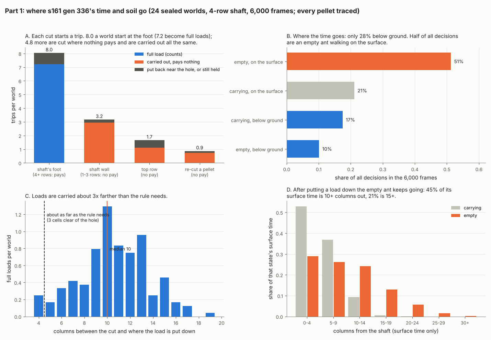

# Investigation: the dig brain and the training process, before the 8-row step

*Started 2026-10-20, after the owner passed dig step 4 on s161 gen 336. Status: in progress (part 1 of 5 done). The plan and
its decisions are in `Reports/handoff/brain-lane-handoff.md`, section 3, item 1.*

Why: about 8 dig steps remain, deeper shafts make full loads rarer, and step 4 alone took about 600 generations along the
winning line. At that rate the rest of the plan costs far more than the $100 Google budget. This investigation asks what
the trained brain actually does and how to train it faster, before more compute is spent.

## Part 1: where loads are lost

**Answer: carrying is solved; the ant loses its time on the surface and on cuts that pay nothing.** Measured on s161 gen
336, 24 sealed worlds, 4-row shaft, 6,000 frames, with every pellet traced from its cut to where it was put down, and every
cut joined to the decision that made it.

- **The trace reproduces the scorer.** A scratch logger (env-gated, never on `main`) wrote every mind decision and every
  cut and put-down. Rebuilding each pellet with the scorer's own jaws rule gives every world's full-load count exactly
  (4, 8, 6, 10, ... for all 24). 38,028 decisions, 330 cuts, 319 put-downs.
- **Each cut starts a trip, and 37% of trips pay nothing.** A world has 8.0 foot cuts (7.2 become full loads, 90%) and
  4.8 cuts that cannot pay: 3.2 into the shaft's wall, 1.7 in the top row, 0.9 re-cuts of pellets. Those are carried out
  and put down away exactly like real loads.
- **Wall cuts are made one row short, from inside the shaft.** The ant is usually 2 rows down and cuts a cell above or
  beside itself (47 of 76 above); most wall cells are 3 rows deep, one short of paying. Its own senses tell the two
  apart: a foot target reads `UP` -0.76 and `DEPTH` 0.28, a wall target `UP` +0.39 and `DEPTH` 0.13.
- **Top-row cuts cost real loads too.** A cut cell joins the hole, so a top-row cut widens the zone a put-down must clear.
  In world 0, two foot pellets carried 11 and 17 columns out still counted as near the hole, beside earlier top-row cuts.
- **Most of the time is surface travel.** Of all decisions: empty on the surface 51%, carrying on the surface 21%,
  below ground 28%. A trip's way back down (put-down to the next foot cut) takes a median 360 frames; the carry up 185.
- **Loads are carried about 3x farther than the rule needs.** The rule needs a put-down 3 cells clear of the hole (about
  4-5 columns from the shaft); the median full load goes 10 columns. Then the empty ant keeps walking out: 45% of its
  surface time is 10+ columns from the shaft, 21% is 15+.
- **Time, not energy, is the limit.** Every ant ends with about 320 of its 1,200 J, and loads keep rising with run length
  (s161 g336, 24 sealed worlds): 4.2, 7.2, 12.3 and 17.0 full loads at 3,000, 6,000, 12,000 and 24,000 frames (budget
  scaled; at 12,000 frames on 1,200 J every ant runs dry and it reads 9.1).
- **Noise against run length:** per-world sd/mean 0.40, 0.31, 0.27, 0.28 at those lengths. Doubling the frames cuts it
  less than doubling the worlds would (0.27 against about 0.22 for the same CPU), so **at 4 rows, more worlds beats longer
  runs** for ranking brains. Part 4 repeats this at 8 rows.

**What it means for the 8-row step:** the below-ground part of every trip roughly doubles, while the surface waste
(overshoot, distant put-downs, unpaid cuts) is unchanged. Cutting that waste would buy loads at both depths: as an upper
bound, turning the 4.8 unpaid trips into foot trips is up to +4.8 loads a world (+66%), before any shortening of the walk.
Part 2 asks what the brain reads when it makes these choices.
