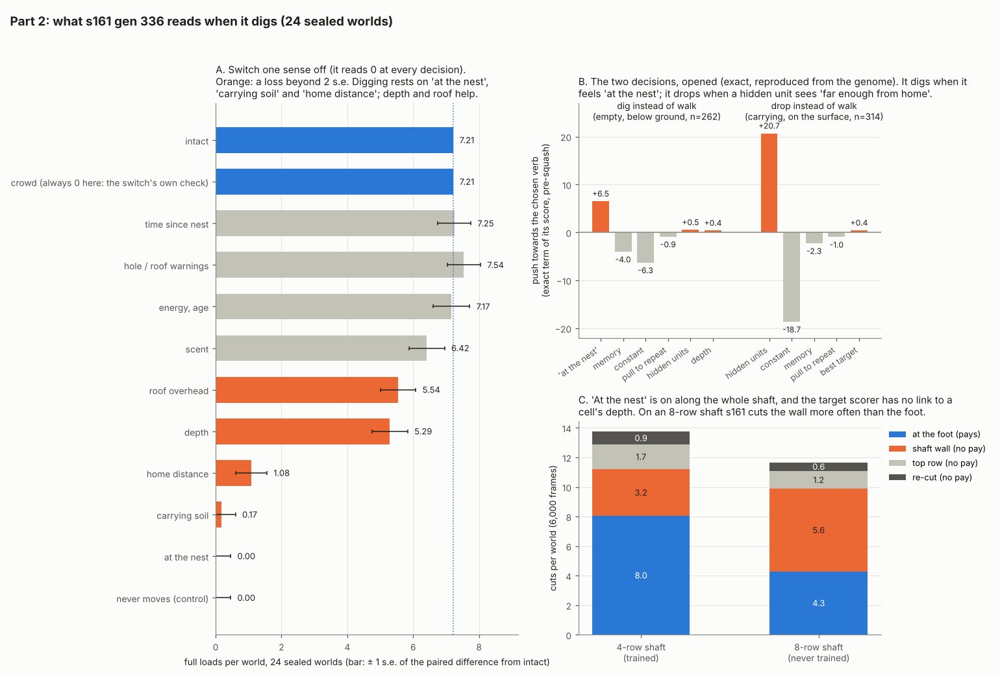
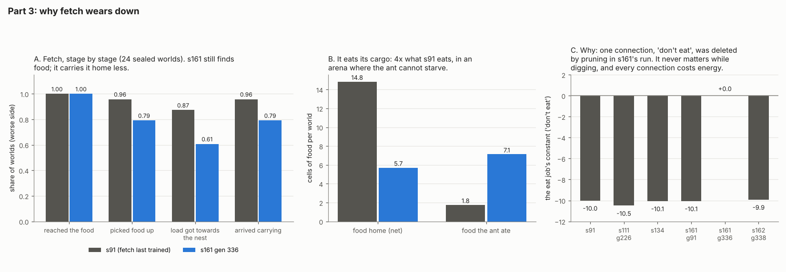

# Investigation: the dig brain and the training process, before the 8-row step

*Started 2026-10-20, after the owner passed dig step 4 on s161 gen 336. Status: in progress (parts 1-3 of 5 done). The plan and
its decisions are in `Reports/handoff/brain-lane-handoff.md`, section 3, item 1.*

Why: about 8 dig steps remain, deeper shafts make full loads rarer, and step 4 alone took about 600 generations along the
winning line. At that rate the rest of the plan costs far more than the $100 Google budget. This investigation asks what
the trained brain actually does and how to train it faster, before more compute is spent.

## Part 1: where loads are lost

**Answer: carrying is solved; the ant loses its time on the surface and on cuts that pay nothing.** Measured on s161 gen
336, 24 sealed worlds, 4-row shaft, 6,000 frames, with every pellet traced from its cut to where it was put down, and every
cut joined to the decision that made it.

- **The trace reproduces the scorer.** A scratch logger (env-gated, never on `main`) wrote every mind decision and every
  cut and put-down. Rebuilding each pellet with the scorer's own jaws rule gives every world's full-load count exactly
  (4, 8, 6, 10, ... for all 24). 38,028 decisions, 330 cuts, 319 put-downs.
- **Each cut starts a trip, and 37% of trips pay nothing.** A world has 8.0 foot cuts (7.2 become full loads, 90%) and
  4.8 cuts that cannot pay: 3.2 into the shaft's wall, 1.7 in the top row, 0.9 re-cuts of pellets. Those are carried out
  and put down away exactly like real loads.
- **Wall cuts are made one row short, from inside the shaft.** The ant is usually 2 rows down and cuts a cell above or
  beside itself (47 of 76 above); most wall cells are 3 rows deep, one short of paying. Its own senses tell the two
  apart: a foot target reads `UP` -0.76 and `DEPTH` 0.28, a wall target `UP` +0.39 and `DEPTH` 0.13.
- **Top-row cuts cost real loads too.** A cut cell joins the hole, so a top-row cut widens the zone a put-down must clear.
  In world 0, two foot pellets carried 11 and 17 columns out still counted as near the hole, beside earlier top-row cuts.
- **Most of the time is surface travel.** Of all decisions: empty on the surface 51%, carrying on the surface 21%,
  below ground 28%. A trip's way back down (put-down to the next foot cut) takes a median 360 frames; the carry up 185.
- **Loads are carried about 3x farther than the rule needs.** The rule needs a put-down 3 cells clear of the hole (about
  4-5 columns from the shaft); the median full load goes 10 columns. Then the empty ant keeps walking out: 45% of its
  surface time is 10+ columns from the shaft, 21% is 15+.
- **Time, not energy, is the limit.** Every ant ends with about 320 of its 1,200 J, and loads keep rising with run length
  (s161 g336, 24 sealed worlds): 4.2, 7.2, 12.3 and 17.0 full loads at 3,000, 6,000, 12,000 and 24,000 frames (budget
  scaled; at 12,000 frames on 1,200 J every ant runs dry and it reads 9.1).
- **Noise against run length:** per-world sd/mean 0.40, 0.31, 0.27, 0.28 at those lengths. Doubling the frames cuts it
  less than doubling the worlds would (0.27 against about 0.22 for the same CPU), so **at 4 rows, more worlds beats longer
  runs** for ranking brains. Part 4 repeats this at 8 rows.

**What it means for the 8-row step:** the below-ground part of every trip roughly doubles, while the surface waste
(overshoot, distant put-downs, unpaid cuts) is unchanged. Cutting that waste would buy loads at both depths: as an upper
bound, turning the 4.8 unpaid trips into foot trips is up to +4.8 loads a world (+66%), before any shortening of the walk.
Part 2 asks what the brain reads when it makes these choices.

## Part 2: what the brain reads

**Answer: it reads the situation, not a motor habit -- but it decides to dig from "am I beside the hole", and it picks
which cell to cut without seeing the cell's depth. That is why it cuts the wall, and the wall gets worse with depth.**

- **The wiring** (s161 gen 336): 706 live links. 8 of the scorer's 16 units reach the score, 6 of the 8 hidden units are
  read by a job. Every situation input but one has some path to a decision, so a static map alone rules little out. One
  gap matters: **no live link carries a target's `DEPTH` feature into the scorer.** When it chooses which cell to cut it
  cannot see how deep that cell is (it reads `UP`, `HEADROOM`, `LINED` and others).
- **The math on real decisions.** A verb's job score is a plain sum before `squash`, so each input's `weight x value` is
  its exact share. Recomputed from the genome file for all 105,854 job scores the brain logged on the 24 sealed worlds:
  median error 0.000025, 0.2% over 0.001 (f32 rounding), so this is the brain that ran.
  - **Dig instead of walk** (empty, below ground): `at_nest` +6.5 against a constant -6.3 and memory -4.0; depth +0.4.
    It digs when it feels at the nest.
  - **Drop instead of walk** (carrying, on the surface): hidden units +20.7 against a constant -18.7. Two hidden units
    make the call: h0 is "not at the nest" (about -0.85 away from it, -0.07 beside it, through a -10.6 weight), h1 is
    "far enough from home" (-48 + 39.5 x carrying + about 40 x `home_dist`; on once `home_dist` passes about 0.2). Loads
    go down at `home_dist` 0.18 on average, against 0.06 while it still walks: that threshold is the 10-column carry.
  - Walking is mostly memory (+3.8 to +4.4) and the best target's score.
- **Switching senses off** (each reads 0 at every decision; 24 sealed worlds, paired against intact 7.21; s.e. about
  0.5): `at_nest` 0.00, carrying (`spoil`) 0.17, `home_dist`+`d_home` 1.08, `depth` 5.29, `roofed` 5.54, scent 6.42;
  time since nest, the hole and roof warnings, energy and age about 7.2 (unused for digging). Controls: `crowd`, which
  is always 0 with one ant, changes nothing to the last digit (the switch does not leak); a never-moving brain reads 0;
  the blind brain 1.0.
- **What `at_nest` is.** Under the default `NestHome::Dug` it is "within one cell of any open cell of the dug hole that
  the door reaches", out to `DUG_HOME_REACH` = 60 rows (`src/sim/creature.rs` `adjacent_nest`, `World::nest_dug`). So it
  is on along the whole shaft and its mouth: the brain's dig trigger is "beside the hole", and the depth-blind scorer
  chooses among foot, wall and rim cells.
- **The prediction, tested on an 8-row shaft** (never trained there; 24 sealed worlds, every pellet traced): wall cuts
  5.6 a world against 4.3 at the foot (47% of cuts pay nothing, against 23% at 4 rows), and 3.7 full loads a world at
  6,000 frames (6.6 at 12,000). Per-world sd/mean 0.45 at both lengths, against 0.31 at 4 rows: noise grows with depth,
  and longer runs do not cut it.

**What it means:** the carrying, the drop rule and the way home transfer to deeper shafts; the choice of *which cell to
cut* does not. Two levers follow, both for part 5 to weigh: let the target scorer see depth (wire `DEPTH` in, or pay a
wall cut less than nothing), and give the dig decision a reason to prefer the foot. Either is cheaper than waiting for
selection to find it through 0.45 noise.

## Part 3: why fetch wears down

**Answer: training deletes the connections that only matter for the protected skills.** Pruning (`prune=0.3`) zeroes
connections at random and every connection costs energy (`wire=`), so a link that never matters while digging is a small
pure gain to delete. Only the kept-skill floor resists, and until `keepref=` that floor followed each run's start.

- **Stage by stage** (fetch, 24 sealed worlds, s91 against s161 gen 336, paired): reaches the food 1.00 and 1.00;
  picks it up 0.96 and 0.79 (-0.17, s.e. 0.08); the load gets towards the nest 0.87 and 0.61 (-0.27, 0.06); **food home
  14.8 and 5.7 (-9.1, 1.2); food the ant ate 1.8 and 7.1 (+5.4, 1.0)**. The fetch ant cannot starve (energy reads a
  constant 0.5), so eating gains it nothing.
- **Traced** (every fetch decision of both brains on the same worlds; their scores reproduce, 23.27 and 17.32): s91
  carries food in 49% of its decisions and walks it home; s161 carries it in 11%, and while carrying it drops it 23% of
  the time, picks it up again 8.5% and eats it 5.5%, mostly at the nest. Both put food down at the nest (95% and 97% of
  drops), so the drop rule itself still serves food.
- **The cause, in the genome.** s91's eat job carries a constant of -10.0 ("don't eat the cargo"); it holds at -10.0 to
  -10.5 down the line to s161 gen 91, and is **0.00 in s161 gen 336** -- deleted. s162 gen 338 kept it (-9.9), and
  s162's fetch held better (0.83 of s91 against 0.75). s91's walk constant (+2.02) was deleted the same way by s111,
  where fetch first dipped.

**What it means:** the fixed floor (`keepref=`) stops the losses compounding across runs but not the pressure: every run
will strip what the floor allows. Levers for part 5: count the kept skills in the score rather than only as a floor;
or stop pruning (and taxing) connections that serve only verbs the learning arena never offers -- Eat has no target
while digging.
