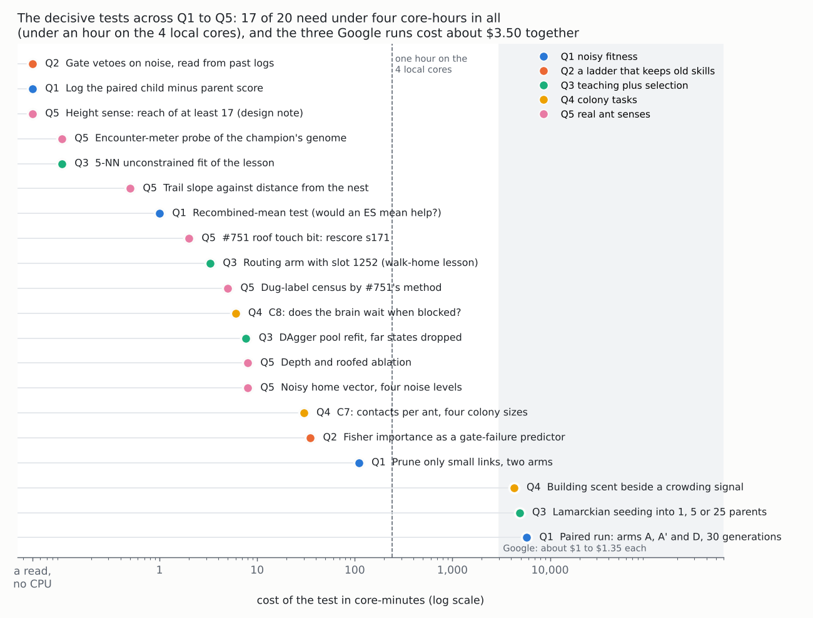

# Field map and ranked list: the ant brain's training problems, Q1 to Q5

*Written 2026-10-21 by the ant-brain research lane. Status: literature and
offline analysis only, nothing built. It summarises the five question
reports in this folder and ranks their tests in one list.*

**Why:** the owner asked for the field's best answers to the brain's hardest
training problems, ranked by what they cost to try here. Each question has
its own report with the evidence. This page is the map across them: what
families of answer the field offers for each problem, which fit a 700-weight
brain trained by a truncation GA on $100 of Google compute and 4 local
cores, and one list of tests, cheapest decisive first.

**Tags** are as in the five reports: [FT] full text read, [ABS] abstract
only, [GK] general knowledge, *here* the project's own code or arithmetic.
This page adds no new claims. Every row points to the section that carries
its evidence.

*Each dot is one test from the five reports, placed by its cost. Three
tests need code first, which the cost does not include: the dug-label probe
(Q5), the noisy home vector (Q5) and the building scent (Q4). The ranked
list below orders them by what they decide, not only by cost.*

---

## 1. The field map

### Q1. Noisy fitness ([report](q1-noisy-fitness-2026-10-21.md))

The problem: a child's score on a few worlds is mostly luck, so selection
keeps lucky children and throws away good ones.

| Family | What it achieved elsewhere | Fit here | Where |
|---|---|---|---|
| More worlds per child, racing | Standard [GK] | Already built (`race=`). The cost is linear | Q1 §3 |
| Paired comparisons, common seeds | Standard [GK] | Already built; log the paired difference so runs can separate arms | Q1 §3 |
| Smaller, safer mutations | Safe mutation: Lehman et al. 2018 [FT] | **Yes, as a pruning fix.** Pruning is size-blind: 28% of children lose a link above 5, and 64% one above 1 | Q1 §1, §5 |
| Online step-size control (1/5 rule, self-adaptation) | Fragile under noise (Beyer 1998 [ABS]) | **No.** It would settle in the wrecking regime. Re-measure σ offline instead | Q1 §2 |
| Mean-based ES and CMA-ES (genetic repair) | Selection errors cancel in the mean [GK] | **Not yet.** One 1-core-minute test says whether a mean update would help | Q1 §4 |

### Q2. A ladder that does not forget ([report](q2-skill-ladder-without-forgetting-2026-10-21.md))

The problem: training a new skill must not lose fetch and trail.

| Family | What it achieved elsewhere | Fit here | Where |
|---|---|---|---|
| Hard gates on old skills (ε-constraint, stochastic ranking) | Standard [GK] | Already built. Check how often it vetoes on noise | Q2 §3 |
| Parameter anchoring (EWC; Early 2019's L2 anchor) | Early 2019 [FT] worked only with a connection cost | **No** as a fitness term. Note: the record misstates Early 2019 | Q2 §1 |
| Graded (Fisher) protection | EWC [GK] | **Only as a pre-screen** for children the gate would veto, if a check shows it predicts | Q2 §2 |
| Stepping stones (CMOEA, lexicase, POET) | Huizinga & Clune [FT] | **Not now.** Reach for CMOEA if a new rung stalls | Q2 §4 |

### Q3. Teaching plus selection ([report](q3-teaching-plus-selection-2026-10-21.md))

The problem: a copied lesson spreads to states it was not meant for, and
DAgger made the copies worse.

| Family | What it achieved elsewhere | Fit here | Where |
|---|---|---|---|
| Behaviour cloning, DAgger, DART | Laskey 2016, 2017 [FT] | **Yes, with fixes.** Refit the pool without far states; match DART noise to the copy's disagreement | Q3 §3c |
| Coaching (soft targets, tightening) | He et al. 2012 [FT] | **Yes.** Close to what the teacher lane is doing | Q3 §3c |
| Search teachers with student rollouts (DPI, LOLS) | Sun 2018, Tesauro 1996 [FT] | **Yes, later.** Gains grow with the student's strength | Q3 §3d |
| Lamarckian against Baldwinian | Castillo 2006, Benito 2026 [FT] | **Lamarckian, into a few parents** | Q3 §3b |
| Self-imitation | Eysenbach 2022 [FT] | **Only per arena, never pooled**, and never on raw returns | Q3 §3e |
| Gated modules (XdG) | Masse 2018 [FT] | A design doc first | Q3 §3a |

The routing audit (Q3 §3a) is the finding to start from. In s161 g340 the
one scorer unit that tells loaded ants from empty ones has no link to the
home feature. So the walk-home lesson can only land on units that loaded
ants read the same way.

### Q4. Colony tasks ([report](q4-colony-tasks-2026-10-21.md))

The problem: the next rungs need many ants working together.

| Family | What it achieved elsewhere | Fit here | Where |
|---|---|---|---|
| Shared genome, colony score | Waibel, Keller & Floreano (teacher notes, C1) | Settled, and built | Q4 §1 |
| Copying a planner in a crowd (PRIMAL; Li 2020) | Fails when trained thinner than tested [FT] | **C7:** train at the game's contacts per ant | Q4 §2 |
| Multi-agent RL in tunnels | Aina & Ha 2025 [FT]: MAPPO collapses past four agents | **C8:** the brain must be able to wait | Q4 §3 |
| A few agents steering by scent | Pitteri 2026 [FT] | **C10:** pioneer ants that fade | Q4 §4 |
| Self-organised digging | Buhl 2005 [ABS]; Rasse & Deneubourg 2001 [ABS] | The building scent, beside a crowding signal | Q4 §5 |

### Q5. Real ant senses ([report](q5-real-ant-sensing-2026-10-21.md))

The problem: every sense must be local and true to a real ant.

| Family | What the biology says | Fit here | Where |
|---|---|---|---|
| Touch and granular mechanics | Arching leaves tunnel-surface grains unloaded (Buarque de Macedo 2021 [ABS]) | **Swap in #751's touch bit** for the roof forecast | Q5 §5 |
| Path integration (central complex) | Built-in; error grows with distance (Stone 2017; Merkle 2006, 2010 [ABS]) | **Keep it as a sense; consider noise.** The owner's call | Q5 §2 |
| Depth templates | CO2 refuted (Tschinkel 2013 [ABS]) | **Ablate depth**; no CO2 field | Q5 §3 |
| Graviception | Hair plates and Johnston's organ; receptor debated | Already true (`f::UP` and footing) | Q5 §3 |
| Quorum by contact rate | Size-invariant (Pratt 2005 [ABS]) | A contact-rate sense, if selection has not built one | Q5 §4 |
| Trail following | Side-by-side, no time integration, Weber's law (Perna 2012 [ABS]) | Already matches; Weber's form only if needed | Q5 §6 |
| Body-size templates for chambers | No digging mechanism known (teacher notes, M7) | A height sense needs reach ≥ 17 for the owner's spec | Q5 §7 |

## 2. The ranked list across all five

Ordered by what each test decides for the work now in flight, cheapest
first within each tier. Costs are from the reports. "Brain" and "teacher"
are the two lanes that own the runs.

**Tier 0: reads and notes, no CPU.**

| Rank | Test | Decides | Owner | From |
|---|---|---|---|---|
| 1 | Count gate vetoes within one standard error of the floor, in past logs | Whether the floor gate throws good children away on noise | Brain | Q2 #1 |
| 2 | Log the paired child − parent difference at race stage 1 | Whether any later run can separate its arms | Brain | Q1 #2 |
| 3 | Encounter-meter probe of the current champion | Whether selection has built a contact rate. In s171: one slow unit reads `crowd`, mixed | Brain | Q5 #4 |
| 4 | Reach of at least 17 for any height sense | That the sense can see an 8–16-cell spec chamber at all | Teacher | Q5 #6 |
| 5 | Correct the "weight protection" line in investigation part 5 | A misstatement of Early 2019 in the record | Brain | Q2 #4 |

**Tier 1: minutes of local CPU.**

| Rank | Test | Decides | Cost | Owner | From |
|---|---|---|---|---|---|
| 6 | Routing arm a′ with slot 1252 | Whether the walk-home lesson stops spreading once the loaded/empty unit can read home | ~3 core-min | Teacher | Q3 #1 |
| 7 | 5-NN unconstrained fit | Whether the spread is in the genome's wiring or in the data | seconds | Teacher | Q3 #2 |
| 8 | #751's touch bit, then rescore s171 on soil and dig | That the honest roof sense costs nothing. Approved | ~2 core-min | Brain | Q5 #1 |
| 9 | DAgger pool refit, dropping far states | Which of three reasons made DAgger hurt | ~8 core-min | Teacher | Q3 #3 |
| 10 | C8 trace: P(Rest) against crowding ahead | Whether the brain already waits when blocked, before any tunnel rung | < 6 core-min | Brain | Q4 #1 |
| 11 | Recombined-mean test | Whether an ES-style mean update would beat truncation | ~1 core-min | Brain | Q1 #4 |
| 12 | Depth and roofed ablation | Whether depth can leave the context | ~8 core-min | Brain | Q5 #2 |
| 13 | Dug-label census by #751's method | Whether `f::CUT` can become touch for free | probe code + minutes | Brain | Q5 #3 |
| 14 | Trail slope against distance from the nest | Whether Weber's form has anything to fix | seconds | Brain | Q5 #7 |

**Tier 2: about an hour of local CPU.**

| Rank | Test | Decides | Cost | Owner | From |
|---|---|---|---|---|---|
| 15 | Prune only small links (τ = 1 and τ = 5), with `noprune=@file` | Whether most of arm A's extra wrecks go. No code since PR #752 | ~55 core-min per arm | Brain | Q1 #1 |
| 16 | C7 sweep: s171 on trail at 3, 6, 12 and 24 ants | Whether colony rungs must match contacts per ant | < 30 core-min | Brain | Q4 #2 |
| 17 | Fisher importance as a gate-failure predictor | Whether graded protection is worth building | ~35 core-min | Brain | Q2 #3 |
| 18 | Coaching schedule, and DART noise matched to disagreement | Whether soft targets that tighten beat hard copies | a copier run per round | Teacher | Q3 #4–5 |

**Tier 3: Google, and only after the tests they depend on.**

| Rank | Test | Waits on | Cost | Owner | From |
|---|---|---|---|---|---|
| 19 | The paired run: arms A, A′ (or C) and D, 30 generations, 2 seeds | Ranks 1, 2, 11 and 15 | ~96 core-hours, ~$1.35 | Brain | Q1 #3 |
| 20 | Lamarckian seeding into 1, 5 or 25 parents | Ranks 6–9: a copy worth seeding | ~81 core-hours, ~$1.10 | Brain | Q3 #7 |
| 21 | Building scent beside a crowding signal, accepted by N against 2N | Ranks 3 and 10, and engine work | ~$1 | Brain | Q4 #4–5 |

**Owner decisions, not tests:**

- **A noisy home vector** (Q5 #5). It is truer, and it would put a search
  for home on screen, but it risks the fetch floor. The evidence to decide
  on is a paired GIF and the fetch score at four noise levels, about 8
  core-minutes once coded.
- **Pioneer ants that fade** (Q4 #6). This is new trainer code and 50–100
  core-hours, so it waits for a colony rung that stalls.

**Not recommended**, with the reason in the report named:

- online step-size control (Q1 §2);
- a full CMA-ES switch before rank 11 (Q1 §4);
- an L2 anchor in the fitness (Q2 §1);
- CMOEA or lexicase before a rung stalls (Q2 §4);
- EWC in the copier, PCGrad, and Baldwinian copy-then-select (Q3);
- graph-network messages and gradient multi-agent methods (Q4);
- evolving path integration from a compass, a CO2 depth field, and any
  time-integrated trail reading into `Move` (Q5).

## 3. What the whole budget looks like

- **Everything in tiers 0 to 2 costs about 3.5 core-hours** (*here*: the
  sum of the costs above). That is under an hour on the 4 local cores.
- **The three Google runs cost about $3.50 together**, out of the $100.
  Each waits on tests that cost minutes and could make it unnecessary.
- **The order follows the critical path.** The teacher lane's next
  experiments are ranks 6, 7 and 9, which Q3 sent as each part was
  answered. The brain lane's next run is shaped by ranks 1, 2, 11 and 15.
