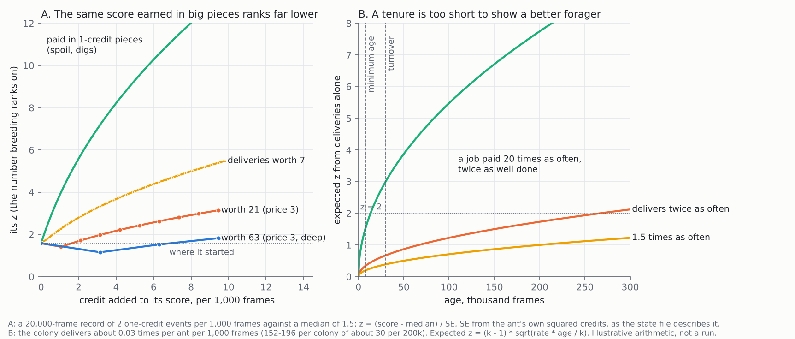

# In-run selection: what the training literature says about the current strategy

*Started 2026-10-21 by the ant-brain research lane, at Scotttt's request
through the teacher lane. Status: literature and offline arithmetic only,
nothing built or run. Sent to the teacher lane on 2026-10-21, and corrected
the same day with two of its measurements (§2, §4). The lane has since also
changed its turnover rules; nothing here depends on those changes.*

**Why:** the teacher lane now breeds the ant brain inside a running colony.
It scores each ant, culls the weakest and lets the strongest breed. Its state
note (`teacher-lane/inrun/in-run-selection-state-2026-10-21.md` in the
project files) and the owner-reviewed design doc
(<https://claude.ai/artifact/DT1eU7tWsJTyaUCLk67pSV>) ask six questions. The
headline result is that selection beats random parents (22 survivors of 24
against 16), but **food brought home does not rise**, and ants spend 50–65%
of their time at the pile.

Scotttt asked for **most depth on the training method, not ant biology**,
which the repo already covers at length. So §1, §2, §4, §5 and §6 are about
method. §3, the biology question, is short.

**Not repeated here:** Waibel, Ferrante and difference rewards
(`Reports/brain-training/teacher-training/notes/evolving_collective_behaviour.md`
Q1, Q2, Q5), racing (`notes/cheap_noisy_evaluation.md`), and pioneers and
Lamarckian copies (this lane's Q3 and Q4).

**Tags:**

- [FT]: I read the full text, or the full relevant sections.
- [ABS]: the abstract only.
- [GK]: general knowledge, not re-read for this report.
- *here*: this project's code, numbers or arithmetic.

**Dead ends checked** by mechanism (steady state, turnover, cull, island,
mutation rate, sigma, freeload, provision, central place, trophallaxis,
tournament, elitism, credit assignment, need price, embodied evolution,
pile). Four entries bear on this report, and none of its proposals retries
them:

- Two `FORAGE_DRIVE` entries (2026-09-27). A fed forager eating the store
  "was never the loss". They re-open when "a colony has a use for stored food
  other than its foragers' bodies (brood, a queen)". §3 builds on this.
- `CarryHome` (2026-10-06). It re-opens when "the colony is fed somewhere
  other than the mound and the door". §3 cites it.
- `reproduce_threshold` at its floor: "A floor is not a margin". It is the
  repo's own freeloading case, in §2.

---

## 0. The answer

1. **Food delivery cannot rise under the score as built, and the cause is
   the method, not the ants.** Two things stack (the picture shows both):
   - **About one delivery per life.** 152–196 deliveries per colony per
     200k frames is about one per ant per 30k-frame tenure. A forager twice
     as good as the median shows z ≈ 0.7 when it is replaced, and needs
     about 270k frames to reach z = 2 *here*.
   - **Ranking on z marks lumpy jobs down.** z divides by the ant's own
     spread of credits, so in the illustrative case one delivery worth 63
     more than doubles an ant's score and *lowers* its z.
2. **Breed on the expected brain (the shrunken mean, as in BLUP), not on
   z.** It does not penalise a big job for being big. Keep z for the cull,
   where caution is the point. *Selection rule: Scotttt's call.*
3. **Pay food the way digs are paid: half as it moves home, half on
   arrival.** One rare lump becomes many small credits. Textbook
   potential-based shaping cannot help: over a lifetime it sums to zero.
   *Scoring: Scotttt's call.*
4. **The food price is not the problem** (measured by the teacher lane
   after this report was sent: it averages 2.83–2.91 against a cap of 3).
   Delivery is already paid near its maximum, which makes the z penalty in
   item 1 as strong as it gets. Giving the nest a mouth (a fixed brood) is
   kept as a later option, not a next arm.
5. **The turnover rule is rtNEAT's law of eligibility.** NERO kept half its
   population too young to judge; here a quarter is. Whether to go faster
   turns on one unmeasured number, how an ant's repeatability grows with
   record length, readable from existing logs.
6. **The z < −3 cull culls 0.7% of healthy ants per tenure if the error bar
   is honest, and 8.5% if it misses a third of the noise.** Calibrate it on
   a colony of clones.
7. **At `pm` 0.03 with `grow` 1 and no pruning (the harness's setting), a
   child gets up to about 84 slot changes, most of them new links, and none
   is ever removed by mutation.** The body bills each live link, so
   starvation is the only brake. Log the live-link count, and test `pm`
   0.01 and `grow` 0.3.
8. **Audit with colony competition before selecting with it.** Mixed
   colonies under colony-level selection were the worst of four setups on
   every task in Waibel 2009, four colonies are few, and replacing one
   every 25k frames is faster than an ant generation, which homogenises.
9. **Teach the walk home first.** Selection cannot raise a skill that does
   not vary; Ferrante found partitioning "much easier to evolve when
   pre-evolved behavioral building blocks were present".

**A flag on the judge:** copy v2 clones kept 3 of 24 alive and the mutant
mix 11.5, so part of what is judged is the mixture. Under the one-brain rule,
also judge clone colonies of each arm's best genome (§5).

---

## 1. Steady-state selection with a noisy, shared score

### 1a. rtNEAT, the closest precedent: Stanley, Bryant & Miikkulainen 2005 [FT]

rtNEAT trained the NERO soldiers inside a running game. Every *n* ticks it:

1. removes the agent with the worst adjusted fitness, among those older than
   the minimum age *m*;
2. picks a parent species with probability proportional to its mean
   fitness;
3. breeds one child into the world.

Its rule for the replacement interval is the **law of eligibility**,
I = m / (|P| · n), where I is the share of the population too young to be
judged. NERO used |P| = 50, m = 500, n = 20 and I = 50%. An agent that keeps
playing has its fitness updated as a leaky average,
f ← f + (s − f)/r with r = 2.

**Here:** m = 8k frames, and |P| · n is the per-adult turnover of 30k
frames, so I = 8/30 ≈ 0.27. NERO's tenure was twice its minimum age; here it
is 3.75 times. rtNEAT warns that too fast a turnover kills agents before they
reach the minimum age, and too slow a one stalls evolution.

### 1b. Why selection froze, and why it must not run too hot [FT]

The state note says selection froze once the colony was healthy, and
turnover was added to restart it. That is the documented weakness of
survival-only embodied evolution. In mEDEA, selection is by survival alone,
so "no more than what is required to survive is foraged" (Montanier,
Carrignon & Bredeche 2016). A fixed turnover is the fix rtNEAT uses, so the
lane's choice matches the literature.

The other end is also measured. With 200 robots and two collocated foods,
extinctions in 50 runs rose from 6 under random selection to 16 under a
tournament of 5, 34 under a tournament of 20 and 32 under elitism. So
exploitation pressure was the danger. The current rule is moderate, and
nothing here argues for making it harsher.

### 1c. Rank breeding on what? z against the expected brain [GK, *here*]

The state note ranks on z = (score − adults' median) / SE, the SE from the
ant's own squared credits. That ranks ants by **how sure we are each is
above the median**, not by **which has the best brain**. For the second,
selection-index theory ranks by the posterior mean E[g | record] (by
linearity of expectation, that maximises the expected brain of the k
picked): the edge over the median, shrunk by the record's reliability:

  EBV = (score − median) × T / (T + λ)

T is the record length and λ the length at which noise and brain weigh
equally. Henderson's BLUP adds relatives: the design doc's "pull each score
toward its family's average", not yet in the state note's score.

**Where they disagree.** For credits of size c at rate ρ, SE ∝ c·√ρ, so at
equal mean an ant paid in lumps 21 or 63 times bigger has an SE √21 to √63
times larger, and its z is that much smaller. Panel A, illustrative:

- One delivery worth 63 takes an ant's score from 2 to 5.15 per 1,000 frames
  and its z from 1.58 to 1.15.
- Three deliveries give 5.7 times the score at about the same z.
- The same added credit in one-credit pieces (spoil, digs) sends z to 13.

So under z-ranking, **the ants that took up delivering rank below the ants
that carried spoil**. In the lane's results, spoil carried out
rose 40%, meals at home rose 16%, and food stayed flat. That fits; it is
not yet shown to be the cause (test 1 in §7 checks it).

**z also has an age bias:** at equal edge it grows as √T, so old ants win
slots over equally good young ones, lengthening the generation interval
(§1e). The cap of 4 kids bounds this. A capped parent would hold a slot
for ever without breeding, and since this report was sent the lane has
made parents retire after 4 children, which closes that.

### 1d. Evidence before culling: repeated looks [FT, *here*]

A z < −3 test looked at once is wrong on 0.135% of healthy ants. Looked at
every 1,000 frames from age 8k, a Monte Carlo on 200,000 simulated healthy
ants gives this *here*:

| Tenure | true noise = SE | true noise 1.25 × SE | true noise 1.5 × SE |
|---|---|---|---|
| 30k | 0.7% | 3.5% | 8.5% |
| 100k | 1.3% | 6.1% | 13.5% |

**The honest case is fine.** The risk is an SE built from the ant's own
credits as if independent: it misses persistent luck (born near the food)
and correlated bursts (a run of digs in one tunnel), and both make it too
small.

Racing (Heidrich-Meisner & Igel 2009) is the formal version: a confidence
interval per candidate, a union bound over the looks, and an
empirical-Bernstein bound whose range term guards against a few lucky lumps.
The cheap version here is to **calibrate**:

- Run a colony of one genome, where every difference is luck.
- Report the standard deviation of z at judging time.
- If it is above 1, divide z by it before the −3 test.

### 1e. How fast to turn over: genetic gain per frame [GK, *here*]

Animal breeding's rate equation (Rendel & Robertson 1950) is:

  gain per unit time = i × r × σ_A / L

- i is selection intensity;
- r is the accuracy of the record, the square root of its reliability;
- σ_A is the heritable spread;
- L is the generation interval.

Turnover trades r against L: a shorter tenure gives a less accurate record
but more generations, and mutational damage per generation pushes back.

The deciding number is how reliability grows with record length. The lane
has one point. Its split-half correlation of 0.76–0.84 over 4 colonies
against 4 converts, by Spearman–Brown, to 0.44–0.57 for one ant in one
colony. That matches "about half brain". But that is over a whole run, not
a 30k tenure, and the two cases point opposite ways:

- **If most noise is Poisson**, reliability over 30k is far lower than 0.5,
  and the tenure is too short.
- **If most noise is persistent luck**, reliability barely depends on
  length, and turnover could double, up to NERO's I = 0.5, at no loss.

**Test (log reading, no run):** cut each ant's record into windows of 4k,
8k, 16k and 32k frames. Correlate a genome's score across windows in
different colonies, and fit reliability(T) = T/(T + λ). λ then sets both
the minimum age and the turnover.

---

## 2. Credit in a colony: need prices, markets and free riders

**Need prices are a first-order difference reward** *here*. If the
colony's welfare is concave in each stock, one unit of work is worth the
welfare's slope there, and p = 1 + 2 × shortfall is that slope for a
quadratic welfare up to the target. So the score already approximates the
Tumer group's difference reward (teacher notes, Q5), with no counterfactual
rollouts.

**MONEE: a market made for exactly this** [FT]. Haasdijk, Bredeche & Eiben
2014 used 100 simulated robots and two kinds of puck. They added "a market
mechanism … according to the market logic that scarcity increases worth".
The scarcity was of *effort*: tasks that few robots perform pay more at
mate selection.

- **Without the market**, "the majority of experiments resulted in a
  population that almost exclusively collects puck of one colour".
- **With it**, both pucks were collected. One puck could be priced up to
  100 times the other and the lesser task still kept "a considerable
  share", so rewards need only be "within one or even two orders of
  magnitude".

**The difference, and what the lane measured.** Our price reads the
store's *stock*, not the colony's *effort*. This report first asked whether
a store that never drains held delivery at its floor price. **Measured by
the teacher lane: it does not.** Over two pilot scores the food price
averages 2.83–2.91 against a cap of 3, sits at the cap 41–47% of the time
and at the floor under 2%. That is because the eaten side counts every
digestion, including bites at the pile. So delivery is already paid near
its maximum, and the limit is §1c and §3, not the price. MONEE's lesson
still stands for later: an effort price keeps a rare job in view without
reading any stock.

**Provisioning or freeloading** [FT, GK]. Waibel, Floreano & Keller 2011
matched Hamilton's rule (rb > c) quantitatively in evolving robots. But
births here come from the *score*, so Hamilton's rule bites only on work the
score does not pay; the low relatedness the family cap imposes is not what
stops provisioning. What stops it is §1c and §3: the payment is rare, lumpy
and ranked on z. That is the repo's own freeloading shape, "an
anti-freeloading condition satisfied by arithmetic and not in fact"
(`dead-ends.md`, `reproduce_threshold`).

---

## 3. Why provisioning does not evolve when an ant can eat at the source

Biology, kept short.

- Central-place foraging theory has animals carry food home because
  **something at home needs feeding**: young for birds (Houston 1987),
  brood and a queen for ants. Real foragers fill a crop at the source and
  pass the food to nest-bound nestmates by trophallaxis [GK].
- In this world, egg-laying is off and there is no brood. Every ant can
  reach the pile, so the only mouths at home are diggers between jobs. The
  world, not just the score, gives a delivery little value.
- The repo found the same thing on 2026-09-27, as noted in the dead-ends
  above.

**Method, which is the part that matters.**

- **A skill nobody shows cannot be selected.** Panel B: at 0.03
  deliveries per ant per 1,000 frames, a forager twice as good as the
  median expects z ≈ 0.7 at turnover; a job paid 20 times as often reaches
  z = 2 inside a tenure.
- **Why potential-based shaping fails here** [GK]. Ng, Harada & Russell 1999
  shaping adds Φ(s′) − Φ(s), with Φ = −(distance home while carrying). It
  leaves the best policy unchanged because it *telescopes*. Over any trip
  that starts and ends empty-handed it sums to zero, and that includes a
  trip abandoned halfway. A lifetime score adds every trip up, so this
  shaping gives selection nothing.
- **What does work: pay the food's journey, once.** Tag each food cell with
  its distance from home when last credited. Pay half its value, prorated,
  as any ant moves it closer, and half when it arrives. That is the dig rule
  already agreed (half on the cut, half on removal), applied to food.
  - It credits partial trips and relays, which is task partitioning, the
    Ferrante setup.
  - It turns one lump of up to 63 into many small credits.
  - One caution: the pieces from one trip are correlated. An SE built from
    the ant's own squared credits will then be too small (§1d), so take
    noise from the colony.
- **Later: give the nest a mouth.** A fixed brood, or a queen eating from
  the store, gives delivery real value in the world. That is the dead end's
  own re-test condition, and the ruling against egg-laying stands because
  births still come from the score. It is not a next arm: the price
  already pays delivery near its maximum.

---

## 4. Mutation rate: in a colony against by generation

**What a child gets today** *here*. The harness calls `train::mutate` with
`pm` 0.03, `sigma` 1, `prune` 0 and `grow` 1 (the teacher lane, after this
report was sent). Each trainable slot, at most 2,797, is drawn with
probability 0.03: up to about 84 slots per child.

- Copy v2 (`v2c.txt` in the lane's genomes folder) has 618 live slots.
  About 19 are drawn and move by a step of sd 1. With `prune` 0 none is
  zeroed.
- Up to about 65 empty slots become new links.

The trainer's own doc measured this: "each child carried about 45 new
connections", and "a mind grew by 25-30 a generation whatever it scored".
The arena holds it with a cost per connection (`wire` 1e-3, the default
since 2026-10-17). In the colony, **the body bills every live link**, so
link growth costs energy and the brake is starvation rather than a score
term. Whether that brake holds the brain's size is what the live-link log
will show.

**What the literature says** [FT for Ochoa 2006; GK for Eigen].

- The error threshold, the mutation rate above which a lineage loses what
  it found, depends mainly on selection pressure and genotype length, and
  rose with tournament size.
- Steady state that replaces the worse of a pair had a clearly higher
  threshold than generational replacement, which Ochoa puts down to
  implicit elitism. "Parents stay" gives the same here.
- The workable rule was about one mutation per non-redundant part of the
  genotype.
- The quasispecies bound puts the harmful mutations per child below ln(the
  best's advantage). With top ants having about 3 children against an
  average of 1, that is ln 3 ≈ 1.1.

Selection per birth here is weak (noisy, a median bar, few births), so the
literature points to **fewer, smaller changes per child than the arena
uses**, not more. Embodied evolution's
practice matches: Montanier 2016 used a Gaussian of σ 0.1 on weights
started in ±1, with 600-step lives.

**Test.** The owner asked for mutation rates to be tested.

- Arms: `pm` 0.01 and 0.03 at `sigma` 1, crossed with `grow` 1 and 0.3,
  for four arms on paired seeds.
- Log two numbers per birth:
  - the child's score minus its parent's at matched age, which is the
    mutational-effect spectrum;
  - the live-link count by generation.
- If the link count climbs, `grow` 0.3 or a small `prune` is the fix the
  arena already validated.

---

## 5. Islands and colony competition

- **Waibel, Keller & Floreano 2009** [FT]: 100 teams of 10, 300
  generations, three tasks. Mixed teams under team selection did worst on
  all three, and same-genome teams won wherever cooperation was needed. Mixed colonies competing as wholes is exactly
  the worst cell: one colony's score says little about any one genome in
  it.
- **Traulsen & Nowak 2006** [GK]: multilevel selection favours
  cooperation when b/c > 1 + n/m (groups of at most n, m groups): many small
  groups, not a few large ones. Four colonies of 24–36 give n/m of 6 to 9.
- **Skolicki & De Jong 2005** [FT]: in island models the migration
  interval mattered more than migration size, and too frequent migration
  let one island take over and lost the diversity islands exist for.
  Replacing a whole
  colony every M = 25k frames is migration of the whole island at an
  interval shorter than one 30k ant generation.

**Recommendation.** The score already prices the shared work, so colony
selection only adds what the score misses. Use it first as an **audit**:
rank colonies by summed ledger and by outcome (survivors, food stored,
nest). If the rankings agree, competition adds little at four colonies'
cost; if they disagree, the score is missing something, so fix the score.

If it is used for selection, select on **clone colonies** of the top
genomes, which is Waibel's best cell. Space the replacements at least 3
generations apart (about 100k frames).

**The judge** *here*. Fresh-colony survivors of 24 were 3 for copy v2
clones, 11.5 for the starting mutant mix, 16 for the random-parent arm and
22 for the score arm. So a monoculture of one brain does much worse than a
mix. One likely reason, unchecked here, is jamming: identical ants make
identical choices. Score against random is a fair test of selection,
because both arms are mixes. But under the one-brain rule the product is a
genome, so also judge **clone colonies of each arm's most common genome**,
as the design doc's "How to judge" intended. If clones keep losing to
mixes, the brain needs a per-ant source of difference from the world (age,
noise, history). That is the owner's "roles from signals" goal, reached
from the other side.

---

## 6. Teach a missing skill before selecting for it?

**Yes, for the walk home.**

- **Variance** [GK]: selection's response is proportional to heritable
  variance (Fisher's fundamental theorem). A skill copy v2 never shows has
  none, and §3 says the colony could not see it anyway at once per life.
- **The bootstrap problem** [GK]: when the rewarded behaviour is too rare to
  appear by mutation, selection gets no gradient (Mouret & Doncieux 2012).
- **Ferrante et al. 2015** [FT]: task partitioning evolved in teams of 4
  robots over 2,000 generations, but a fitness-landscape analysis found it
  "much easier to evolve when pre-evolved behavioral building blocks were
  present".

It was left to selection because teaching it in a dig-only arena leaks
into foraging (design doc), which does not apply in a food-and-dig colony.

- **How:** this lane's Q3 report. The walk-home lesson spreads through
  routing (scorer unit 14 has no `home` link, at slot 1252). Write the
  lesson into a few founders (Lamarckian), or seed pioneer ants that fade
  (Q4's C10).
- **Test:** the lesson written into 5 of 24 founders against none, paired
  seeds, current score; measure food delivered and deliveries per ant.

---

## 7. Ranked tests, cheapest decisive first

Costs are in runs of the lane's current pilot (one colony, 600k frames, on
one core). This lane does not know its wall time.

| # | Test | Cost | Decides |
|---|---|---|---|
| 1 | From existing logs: ~~the food price over a run~~ (done: near its cap); deliveries per ant; how often z-rank and score-rank pick different parents; child minus parent at matched age; live links by generation | 0 | whether §1c, §2 and §4 are live |
| 2 | Reliability against window length (§1e) | 0 | min age and turnover |
| 3 | One clone colony: the spread of z at judging | 1 | whether the −3 cull is honest |
| 4 | Clone-colony judge of each arm's top genome | 1 per arm | what the one-brain product scores |
| 5 | Breed on the shrunken mean against z, plus random, paired | 3 | §1c (*Scotttt*) |
| 6 | Food paid half on progress, half on arrival | 2 with control | §3 (*Scotttt*) |
| 7 | `pm` 0.01/0.03 × `grow` 1/0.3 | 4 | §4 (owner asked) |
| 8 | Walk-home lesson in 5 founders against none | 2 | §6 |
| 9 | A fixed brood sink at the nest (later: price already near its cap) | 2 with control | §3 (*Scotttt*) |
| 10 | Colony audit: ledger rank against outcome rank, 4 colonies | 4 | §5 |

Tests 1 and 2 cost nothing and decide whether 5, 6 and 7 are worth running.

**For Scotttt, two one-word decisions, each as a paired arm first:**

- **Rank on the shrunken mean instead of z?** Recommend *yes*.
- **Pay food on progress?** Recommend *yes*.

A third, giving the nest a mouth, was dropped for now once the lane measured
the food price near its cap.

---

## Sources

- Stanley, K. O., Bryant, B. D. & Miikkulainen, R. (2005). Real-time
  neuroevolution in the NERO video game. *IEEE TEC* 9(6):653–668.
  doi:10.1109/TEVC.2005.856210 [FT]
- Montanier, J.-M., Carrignon, S. & Bredeche, N. (2016). Behavioral
  specialization in embodied evolutionary robotics: why so difficult?
  *Front. Robot. AI* 3:38. doi:10.3389/frobt.2016.00038 [FT]
- Haasdijk, E., Bredeche, N. & Eiben, A. E. (2014). Combining
  environment-driven adaptation and task-driven optimisation in
  evolutionary robotics. *PLoS ONE* 9(6):e98466.
  doi:10.1371/journal.pone.0098466 [FT]
- Heidrich-Meisner, V. & Igel, C. (2009). Hoeffding and Bernstein races for
  selecting policies in evolutionary direct policy search. *ICML 2009*.
  <https://icml.cc/imls/conferences/2009/papers/229.pdf> [FT]
- Waibel, M., Keller, L. & Floreano, D. (2009). Genetic team composition and
  level of selection in the evolution of cooperation. *IEEE TEC*
  13(3):648–660. doi:10.1109/TEVC.2008.2011741 [FT]
- Waibel, M., Floreano, D. & Keller, L. (2011). A quantitative test of
  Hamilton's rule for the evolution of altruism. *PLoS Biol* 9(5):e1000615.
  doi:10.1371/journal.pbio.1000615 [FT]
- Ferrante, E. et al. (2015). Evolution of self-organized task specialization
  in robot swarms. *PLoS Comput Biol* 11(8):e1004273.
  doi:10.1371/journal.pcbi.1004273 [FT]
- Skolicki, Z. & De Jong, K. (2005). The influence of migration sizes and
  intervals on island models. *GECCO 2005*.
  <https://gpbib.cs.ucl.ac.uk/gecco2005/docs/p1295.pdf> [FT]
- Ochoa, G. (2006). Error thresholds in genetic algorithms. *Evolutionary
  Computation* 14(2):157–182. doi:10.1162/evco.2006.14.2.157 [FT]
- Traulsen, A. & Nowak, M. A. (2006). Evolution of cooperation by multilevel
  selection. *PNAS* 103(29):10952–10955. doi:10.1073/pnas.0602530103 [GK]
- Ng, A. Y., Harada, D. & Russell, S. (1999). Policy invariance under reward
  transformations. *ICML 1999* [GK]
- Rendel, J. M. & Robertson, A. (1950). Estimation of genetic gain in milk
  yield by selection in a closed herd of dairy cattle. *J. Genetics*
  50:1–8. doi:10.1007/BF02986789 [GK]
- Henderson, C. R. (1975). Best linear unbiased estimation and prediction
  under a selection model. *Biometrics* 31:423–447. doi:10.2307/2529430 [GK]
- Mouret, J.-B. & Doncieux, S. (2012). Encouraging behavioral diversity in
  evolutionary robotics: an empirical study. *Evolutionary Computation*
  20(1):91–133. doi:10.1162/EVCO_a_00048 [GK]
- Houston, A. I. (1987). Optimal foraging by parent birds feeding dependent
  young. *J. Theor. Biol.* 124:251–274 [GK]
