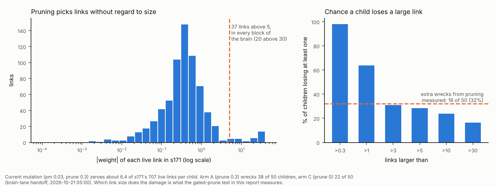

# Noisy fitness on a small budget: mutation size, selection and search method

*Started 2026-10-21 by the ant-brain research lane. Status: literature and
offline analysis only, nothing built. Sent to the brain lane on 2026-10-21.*

**Why:** the GA cannot easily tell brains apart, and most of the children it
pays to score are broken. This report asks what the field knows about each of
those for a truncation GA on a small recurrent brain:

- adaptive mutation size (the 1/5 rule, self-adaptation, CMA-ES and its
  separable form);
- selection under noise;
- how to trade population size against worlds per brain.

It does not repeat the teacher lane's `notes/cheap_noisy_evaluation.md`
(racing, AS-CMA, LEEA, population control, common random numbers) or
investigation part 5's lever table (`Reports/brain-training/investigation-2026-10-20.md`).

**Tags:**

- [FT]: I read the full text.
- [ABS]: the abstract only.
- [GK]: general knowledge, not checked this session.
- *Here:* the project's own measurement or arithmetic.

**Dead ends checked:** `Reports/dead-ends.md` has no entry for pruning a
brain's links, step-size rules, self-adaptation, CMA-ES or safe mutation
(grepped by mechanism, 2026-10-21).

### The measured noise, from its sources

- **Investigation part 4** (s161's and s162's final parents, two independent
  48-world sets each):

  | Arena | Spread between brains (sd) | Per-world noise (sd) | Ratio | Agreement of two 48-world sets | Worlds for 0.7 agreement |
  |---|---|---|---|---|---|
  | 4 rows, 6,000 frames | 0.21 | 2.02 | 0.10 | 0.38 | 210 |
  | 8 rows, 12,000 frames (the current arena) | 0.57 | 2.55 | **0.22** | 0.52 | 47 |

  "Brains differ by a tenth of the noise" was the 4-row arena. In the current
  arena the ratio is about 0.22.
- **Brain-lane handoff, 2026-10-21 05:00.** 50 children of s171 per setting,
  each scored on two 48-world sets, at 8 rows and 12,000 frames. The parent
  scores 9.47.

  | Arm | pm | sigma | prune | Weights changed | Median child | Clearly worse | Clearly better |
  |---|---|---|---|---|---|---|---|
  | A (current) | 0.03 | 0.3 | 0.3 | 27 | 5.74 | 38 of 50 | 0 |
  | B | 0.01 | 0.1 | 0.3 | 9 | 9.52 | 11 | 0 |
  | C | 0.03 | 0.3 | 0 | 28 | 8.71 | 22 | 0 |
  | D | 0.01 | 0.1 | 0 | 9 | 9.54 | 1 | 2 (about chance) |

  - The p90 child was 9.6–9.9 in every arm.
  - A generation of truncation selection gained +0.21, +0.27, +0.06 and
    +0.32 against the parent's score on set 1, all well inside the noise.
- **Brain-lane handoff, round 3.** A run with smaller mutations from s134
  (s151–s154) was stopped at generation 8, as far below its start as round 2.
  It selected on 16 worlds, which part 4 later showed was mostly picking
  luck, so it does not settle mutation size either way.

---

## 1. The cheapest lever is to stop pruning large links

**Answer: pruning zeroes a link without regard to its size. The brain keeps
some of its most important decisions in a few links near the ±40 clamp, so
about a quarter of children lose one of them. Pruning only small links should
keep the wire-cost pressure and remove most of arm A's extra wrecks. An
offline test settles it in under an hour of CPU.**

**What `train::mutate` does** (`src/train/mod.rs`, `fn mutate`):

- A slot hit with probability `pm` is either zeroed (probability `prune`, if
  live) or stepped by `sigma`.
- In s171 (`training/starts/s171-8-g79.txt`) that zeroes about
  707 × 0.03 × 0.3 ≈ 6.4 live links per child, chosen uniformly.

**How the link sizes are spread:**

- The median |w| is 0.39.
- 37 links are above 5, and 20 are above 30. They sit in every block of the
  brain: 9 in the job head's hidden units, 5 each in the scorer's features,
  the job rows and memory, and 4 each in the scorer's context and outputs.
- Q3 shows what one of them does: s161's spoil → unit 14 link at +31.7 is
  the whole of the empty-or-loaded split.

**Exposure, here:**

- A child has a 28% chance of losing at least one link above 5, and 64% of
  losing one above 1.
- Pruning adds 16 wrecks per 50 children (arm A against arm C), or 32%. That
  is the same order.

**The field's version is safe mutation.** Lehman, Chen, Clune & Stanley 2018
(GECCO; arXiv 1712.06563) [FT]:

- A random perturbation of many weights "will likely break existing
  functionality", and weights differ enormously in sensitivity.
- Their fix scales each weight's perturbation by the output's sensitivity to
  that weight, measured on the parent's own recorded inputs, so it needs no
  extra rollouts.
- Results:
  - **Recurrent parity** (~1,300 parameters): every gradient-scaled variant
    solved the task significantly faster than plain Gaussian mutation
    (p < 0.001), and solutions were more robust to later mutation.
  - **A 1,266-parameter maze controller:** the second-order variant was
    faster (p < 0.005), and the absolute-gradient variant was the only one to
    solve all 20 runs.
  - **Caveat:** the summed-gradient variant was no better than control there,
    and plain rescaling (SM-R) did poorly.
- For a deletion the perturbation *is* the weight, so the crudest form of
  their idea is simply: do not delete big weights.

**Cheapest test:** the 05:00 harness, unchanged, with one new arm.

- **A′** is arm A with magnitude-gated pruning: zero a link only if
  |w| < τ, say τ = 1, and otherwise step it.
- Run 50 children of s171 on reliab's two 48-world sets: 50 × 96 × 0.68 s ≈
  55 core-minutes, about 15 minutes on 4 cores.
- **Reading:**
  - If A′'s clearly-worse count falls from 38 to near C's 22, the extra
    damage was the big links.
  - If it stays near 38, pruning hurts through many small links, and the
    answer is `prune` 0 with the wire cost alone.
- **A second arm, A″ (τ = 5),** separates which of the two sizes matters, at
  the same cost again.
- **One fact to record in the same run:** whether gated pruning still holds
  the live-link count against `grow` (`Settings::grow`'s doc gives the drift
  balance). New links are born small (σ-sized), so gating at τ ≥ σ should
  leave the balance where it is. That is an inference; count it.

**Update, 07:05Z the same day:** `noprune=` landed on `main` (PR #752).
`mutate` now takes a `keep` mask (`src/train/mod.rs`, `fn mutate` and
`no_prune_mask`), so arm A′ needs no new trainer code:

- **In the harness:** pass a mask that is true where |w| > τ in the parent.
- **In a run:** use `noprune=@file`, listing s171's 112 slots above 1, or
  its 37 above 5.

That is a fixed list taken from the parent, not a live gate: a link that
grows past τ later stays prunable. That makes no difference for a
one-generation test. Note that a listed scorer input also keeps its unit's
output weight, which adds a few slots to each list.

The arm is still the brain lane's to run. It is smaller than any step-size
scheme below.

## 2. Mutation size: fix it from measurement, and do not adapt it online yet

**Answer:**

- **The 1/5 success rule would settle in the wrecking regime here.**
  Self-adaptation is fragile under noise, and the theory does not agree on
  how fragile.
- The measured cheap substitute is better: re-run the offline 50-child test
  every few dozen generations, and set σ so that a target share of children
  is clearly worse.

**The 1/5 rule.** Rechenberg's rule [GK] raises σ when more than a fifth of
children beat their parent, and lowers it otherwise. Under this noise:

- A near-neutral child "beats" its parent about half the time on 48 worlds.
  Arm D's median child (9.54 against 9.47) is exactly that.
- So the rule would keep raising σ until real damage pulled the apparent
  success rate down to a fifth.
- In the 05:00 table that is somewhere between arm C (median 8.71) and arm A
  (median 5.74): the settings that wreck half or more of the children.
- *Here, inference from the measured table:* the rule measures noise, not
  progress.

**Self-adaptation (σ carried in the genome):**

- Beyer 1998 ("Mutate large, but inherit small", PPSN) [ABS]: standard
  self-adaptation "has considerable problems to drive the ES in its optimum
  working regime" on noisy fitness, and needs remedies.
- Lehre & Qin 2023 (FOGA) [ABS]: on a discrete benchmark, self-adapted
  mutation rates tolerated noise better than fixed ones.
- The two disagree, on problems far from ours. Each self-adapted σ is itself
  selected on noisy scores, so it inherits the same signal-to-noise problem
  as the weights.

**Cumulative step-size adaptation (CSA), the CMA-ES default:**

- Arnold & Beyer 2004 (IEEE TAC) [ABS] analyse it with noise and make
  population-size recommendations.
- It needs a mean-based ES (§4), not a truncation GA.

**What to do instead** (*here*):

- Treat σ, pm and prune as settings measured offline, as the 05:00 test did.
- Re-measure every 30–50 generations, because the right size moves as the
  brain grows big gates.
- Target a clearly-worse share. Arm D's 1 in 50 is probably too timid: see
  §3 for why a mutation that changes nothing also gains nothing.
- **Cost:** about 55 core-minutes per setting checked, off the VM.

## 3. Selection under noise: why "too small" is as bad as "too big"

**Answer:** the breeder's equation [GK], applied to the measured numbers,
explains why the 05:00 test could not separate the arms in one generation. It
also says what a training run should log so that the paired Google run can.

Expected gain per generation in true score:

- R = i · ρ · σ_G, where:
  - i is the selection intensity (truncation to 25 of 100 gives i ≈ 1.27);
  - σ_G is the true spread of the children's quality;
  - ρ = σ_G / √(σ_G² + σ_N²/n) is how well n worlds rank them.
- When mutation is small, σ_G is small compared with σ_N/√n, and R falls as
  σ_G². A mutation that hardly changes the brain gains nothing, however
  safely.
- When mutation is large, σ_G is large but the child distribution sits far
  below the parent (arm A's median 5.74). Truncation then spends its picks
  culling, and the top quarter is no better than at small σ (p90 9.6–9.9 in
  every arm).
- The best setting is the classic "evolution window" [GK]: big enough that
  the children's upper tail clears the noise, and small enough that the tail
  is not wrecked.
- **A consistency check** (*here*): with σ_G = 0.22 σ_N, n = 48 and i = 1.27,
  R ≈ 1.06 σ_G ≈ 0.6 full loads a generation at most. Among one parent's
  near-neutral children σ_G is far smaller than among a run's parents, so
  +0.06 to +0.32 is the expected size.

**Population against worlds, at a fixed budget of 4,800 worlds a
generation** (*here*, from the same equation, σ_G = 0.22 σ_N, keeping
25 parents):

| Population × worlds | Truncation share | i | ρ | Gain (in σ_G) |
|---|---|---|---|---|
| 50 × 96 | 0.50 | 0.80 | 0.91 | 0.73 |
| **100 × 48 (now)** | 0.25 | 1.27 | 0.84 | 1.06 |
| 200 × 24 | 0.125 | 1.65 | 0.73 | **1.21** |
| 400 × 12 | 0.0625 | 1.97 | 0.61 | 1.19 |

- In the current arena, *more children on fewer worlds* gains up to about 14%
  per generation, before any racing. These are infinite-population
  formulas with normal tails, so read them as direction, not as a forecast.
- This is the analytic reason racing (`race=8`) is right. It is the same move,
  done adaptively.
- Rattray & Shapiro 1996 (FOGA) [ABS] derive the same thing for a GA: in the
  weak-selection limit, the effect of evaluation noise can be removed by
  enlarging the population, which sets an optimal sample size per
  evaluation.
- **The 0.7-agreement target in part 4 is the wrong bar for selection.**
  Selection needs ρ at the cut, not a reliable score for each brain.

**Truncation prefers lucky, high-variance brains.** Goschin, Littman & Ackley
2011 (GECCO) [ABS]: under noise, proportional selection optimises expected
fitness, while truncation optimises an *order statistic*, so it rewards
brains whose score varies. The worse-side fold over mirrored pairs (part 4)
already pushes against that. Keep it wherever it costs no ranking accuracy;
at 12,000 frames it costs none (part 4: 0.53 against 0.52).

**What to log, at no cost.** Every raced generation already scores every
child on the first 8 worlds. Log each child's 8-world score minus its
parent's 8-world score on the same salts. The per-generation spread of that
paired difference, minus the paired noise, is an estimate of σ_G. The
paired Google run can then report the gain per generation *and* σ_G per arm,
not just a final score.

## 4. CMA-ES, separable CMA-ES and implicit averaging

**Answer: do not switch search methods yet. But one test, on numbers that
already exist, says whether an ES-style mean update would beat truncation
here. It costs about one core-minute.**

**What a mean-based ES buys under noise:**

- A (μ/μ, λ)-ES moves its parent to the weighted *mean* of the selected
  children's mutations. Selection mistakes partly cancel in the average.
  Beyer calls this genetic repair [GK].
- "Mutate large, but inherit small" (Beyer 1998 [ABS]) is the noisy-fitness
  form: evaluate big steps, so the signal clears the noise, but move the
  parent by only a fraction of them.
- Hansen's CMA-ES adds covariance learning. Full CMA-ES is quadratic in the
  dimension: about 700² ≈ 490,000 covariance entries here, learned at a rate
  of order 1/n².
- Ros & Hansen 2008 (sep-CMA-ES, PPSN) [ABS]: a diagonal covariance is linear
  in time and space, can learn faster, and "for dimensions larger than a
  hundred, even on the non-separable Rosenbrock function, the sep-CMA-ES
  needs fewer function evaluations than CMA-ES".
- **Noise handling:**
  - Heidrich-Meisner & Igel 2009 (UH-CMA-ES for RL, GECCO) [ABS]: adjusting
    the number of episodes per evaluation so that the ranking is "just high
    enough" improved both speed and robustness. That is racing, which the
    rig has.
  - Uchida, Nishihara & Shirakawa 2024 (arXiv 2405.11471) [ABS]: enlarging
    the population or shrinking the learning rate works under *additive*
    noise but can miss the optimum under *multiplicative* noise, where
    re-evaluation is needed.
  - Our per-world noise may be partly multiplicative: its sd rose from 2.02
    at 4 rows to 2.55 at 8 rows as scores rose with depth. That is an
    inference from two points, not a measurement. The brain lane's queued
    racing A/B is where it would show.

**Why not switch now:**

- The genome is not a fixed vector. Links are born (`grow`) and pruned, and
  the wire cost is a cost on the *count* of live links. A Gaussian over a
  fixed set of coordinates fits none of that without a redesign. sep-CMA over
  the 707 live slots only (a fixed topology) is possible, but it gives up the
  wire cost's job.
- Investigation part 5 ranked "a different search method" below evaluation
  savings, and nothing here changes that.

**The cheapest test, which needs no new runs.** From arm D's 50 children of
s171 (regenerated deterministically if they were not saved):

1. Rank the children on set 0.
2. Take the top 12 and average their mutation vectors (child − parent), with
   weights by rank.
3. Add the average to the parent, giving one "recombined" brain.
4. Score it on set 1 (48 worlds ≈ 33 core-seconds), and compare it with the
   +0.32 that truncation's pick made on set 1.

- If the recombined brain gains clearly more, implicit averaging works on this
  landscape, and a design doc for an ES-style mean step is worth writing.
- If not, truncation is not losing much, and the GA stays.
- Repeat on arm C's children for the larger step. Arm C is the "mutate large"
  half of "mutate large, inherit small".

## 5. A safe-mutation screen before any world is run

**Answer:** worth one offline correlation check, not a build.

- The brain's decisions can be recomputed in Python from logged inputs
  (investigation part 2; the teacher lane's copier does it). So for any child
  it is cheap to count how many of its parent's logged decisions it would
  *change*.
- If that flip rate predicts a child's 96-world score, children can be
  rejected or rescaled before they cost a world. That is SM-R in Lehman
  et al.'s terms, with decision flips as the divergence measure.

**Test:**

- For the 200 children of the 05:00 test (or regenerated), compute the flip
  rate on the parent's logged decisions. Rank-correlate it with each child's
  measured score against the parent.
- Cost: minutes, on numbers that exist.
- **Reading:**
  - A strong correlation (Spearman above about 0.6) makes a free stage 0 of
    racing.
  - A weak one says damage comes from rare states the log does not hold,
    which is itself worth knowing for the copier's keep anchors.
- **A caution from the paper:** rescaling was their weakest variant on the
  maze, and the gradient-scaled ones won. A screen is a filter, not a
  substitute for gated pruning (§1).

---

## Ranked list for Q1

| # | Technique | Evidence | Cheapest test | Cost | Owner |
|---|---|---|---|---|---|
| 1 | Magnitude-gated pruning (A′, τ = 1; A″, τ = 5) | here (exposure 28–64%, against +16 wrecks per 50); Lehman 2018 [FT] | the 05:00 harness, 50 children per arm | ~55 core-min per arm, local | brain lane |
| 2 | Log the paired child − parent difference at race stage 1 | breeder's equation [GK] | none: a log line | 0 | brain lane |
| 3 | The paired Google run, with arms A, A′ (or C) and D, 30 generations, 2 seeds | the 05:00 test cannot separate arms in one generation | 3 arms × 2 seeds × 30 gens × ~32 core-min (raced) | ~96 core-hours, ~$1.35 | brain lane |
| 4 | Recombined-mean test on arm D's and C's children | genetic repair [GK]; Beyer 1998 [ABS] | one brain on 48 worlds per arm | ~1 core-min | brain lane, or this lane if handed the genomes |
| 5 | Safe-mutation screen (decision-flip rate) | Lehman 2018 [FT] | a correlation over 200 children | minutes | either |
| 6 | Re-measure σ offline every 30–50 generations | here | the 05:00 harness | ~55 core-min per setting | brain lane |
| — | 1/5 rule, self-adapted σ, full CMA-ES | here (the rule tracks noise); Beyer 1998 [ABS]; quadratic cost | — | not recommended | — |
| — | sep-CMA-ES over live slots | Ros & Hansen 2008 [ABS] | only after #4 says a mean update helps | a design doc | — |

The Google cost assumes ~54 core-minutes for an unraced generation, 41% less
with `race=8`, and ~$0.014 per vCPU-hour (the brain lane's figures).
