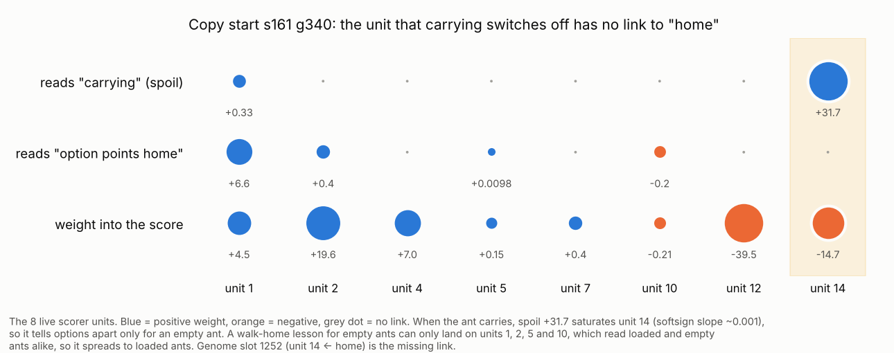

# Teaching plus selection: what the field says, for the ant's copier

*Started 2026-10-21 by the ant-brain research lane. Status: literature and
offline analysis only, nothing built. Each sub-answer was sent to the teacher
lane as it was finished (3a at 06:32Z, 3b–3e at 06:36Z).*

**Why:** the teacher lane can now *find* far better behaviour than selection
does (s161 6.80 → 20.66 and s171 9.47 → 20.50 under the search teacher), but
copying it into the 700-weight brain loses most of the gain. The best copy so
far is the go-down rule alone, at 10.57 / 10.60 / 9.80. All three rules
together reach 8.64. Dig alone gets 3.35 and walk home alone 7.03. DAgger made
both copies worse: 8.64 → 6.34, and 10.57 → 9.50. Five questions follow from
that. Why does a copied lesson leak into states that merely look like its own?
Should a copy be written into the genome before selection runs? Which
planner-teacher designs suit a brain this small, and why did DAgger hurt? What
does a search label cost? And what is the known flaw in copying your own past
successes?

**What this builds on, and does not repeat.** The teacher lane's notes
(`Reports/brain-training/teacher-training/notes/` on branch
`ccr-439ee31b-pn36yq`) already cover privileged teachers, ADVISOR, A2D, Swamy,
basic DAgger and kickstarting. This report adds only what is not in them.

**Evidence tags:**

- [FT]: I read the full text.
- [ABS]: the abstract only.
- [WS]: a web-search summary.
- [GK]: general knowledge, not checked this session.

Every claim a recommendation rests on is [FT].

**Dead ends checked.** `Reports/dead-ends.md` has no entry for DAgger,
coaching, Lamarckian or Baldwinian write-back, self-imitation, EWC or Fisher
penalties, or unit gating (grepped by mechanism, 2026-10-21).

---

## 3a. Why a copied lesson spreads to look-alike states

**Answer: in this genome it is a routing fact before it is anything else.**

- The lesson walk home is meant for empty ants. The one scorer unit that tells
  empty ants from loaded ones has no link to the feature the lesson uses. So
  the copier can only write the lesson onto units that loaded ants read the
  same way.
- The test is one allow-listed link (slot 1252) on an arm the teacher lane
  already has. It takes about 200 s of copier time.

### The audit

I read the copy start (`Reports/brain-training/stage2/dig/4b4/dig-4b4-s161-g340-hold-best.txt`,
706 links), using the layout in `src/sim/creature/mind.rs`:

- `S_CTX` starts at slot 23, with 35 inputs per unit.
- `S_FEAT` starts at slot 583, with 45 features per unit.
- `S_OUT` starts at slot 1447.

Eight of the sixteen scorer units have a weight into the score:

| Unit | Reads carrying (`c::SPOIL`) | Reads "option points home" (`f::HOME`, f 39) | Weight into score |
|---|---|---|---|
| 1 | +0.33 | **+6.63** | +4.53 |
| 2 | — | +0.40 | +19.56 |
| 4 | — | — | +7.02 |
| 5 | — | +0.0098 | +0.15 |
| 7 | — | — | +0.40 |
| 10 | — | −0.20 | −0.21 |
| 12 | — | — | −39.45 |
| **14** | **+31.69** | **— (slot 1252 not live)** | −14.74 |

**How unit 14 works as a gate:**

- The squash is softsign, `x/(1+|x|)` (`mind.rs`, `fn squash`).
- When the ant carries, unit 14's input sits near z ≈ 32, where the slope is
  1/33² ≈ 0.001. The unit is then pinned at a constant and adds the same
  amount to every option.
- It ranks options only when the ant is empty. It is the brain's own
  empty-only unit, which evolution built for the dig rung.
- It has no `home` link.
- The units that do carry `home` (1, 2, 5 and 10) read loaded and empty ants
  the same way. The one exception is unit 1, through a 0.33 carrying link.
  That link would have to grow about a hundredfold against the keep anchors
  before it could separate the two.
- s171-8-g79 is built the same way: spoil +31.7 on unit 14, and home on
  units 1, 2 and 10.

**This explains the measured spread.** After the walk-home copy, surface
carrying rose from 17% to 47%. Walk home was being applied to loaded ants.

**Cheapest test.** Run arm (a′): the teacher lane's arm (a), plus slot 1252
(unit 14 ← home) on the allow-list, plus unit 14's link to any other feature
that walk home's labels move.

- If (a′) matches the bigger-capacity arm (b) on the loaded-soil anchors, the
  fix costs one link, not a change of capacity.
- Cost: one copier run, about 200 s on one core.
- This does not touch the spread to empty fetch foragers. Unit 14 is live for
  them too, so that case stays with the teacher lane's context probe.

**The one test that separates capacity, context and contradictory labels:**
arm (d).

- Arm (d) is an unconstrained fit on the same logged inputs (context, memory,
  and the option's 45 features). A 5-nearest-neighbour fit in numpy takes
  seconds.
- The teacher lane's arms already compare "more units" (b) with "a context
  input" (c). "Neither fits" cannot tell a teacher problem from a scorer
  problem; (d) can:

| (d) on held-out states | (b) or (c) | Reading |
|---|---|---|
| fails on the home and keep groups | — | the labels contradict on states the ant cannot tell apart: a teacher problem, and no brain change helps |
| fits | (b) fits | capacity |
| fits | (c) fits, (b) does not | context |
| fits | neither fits | the scorer's additive form, not slot count |

### Why lessons spread at all, and the fixes ranked

Lee, Goldt & Saxe 2021 (ICML; arXiv 2107.04384) [FT] worked this out in a
teacher–student model of sequential tasks.

- Forgetting is worst at intermediate task similarity: two tasks that share
  their inputs but need different readouts.
- Very similar tasks transfer, and very different tasks do not interfere.
- Walk home against carrying out is the bad middle case: the same home
  feature, needed with opposite signs depending on load.
- So spreading is expected wherever a lesson's trigger is not itself an input
  the units can separate on.

The fixes, in order of cost:

1. **Route the lesson through an existing gated unit.** This is the audit
   above: one link.
2. **If the context probe fails, revive a dead unit gated on a sense that
   separates the arenas.** This is the analogue of context-dependent gating
   (XdG).
   - Masse, Grant & Freedman 2018 (PNAS; arXiv 1802.01569) [FT] tested this
     on a recurrent net learning a sequence of cognitive tasks.
   - Synaptic stabilisation (SI) plus a rule cue as an extra input reached
     80.0% mean accuracy. SI plus gating reached 98.2%.
   - A cue as just another input is weaker than a cue that switches units on
     and off. Unit 14 is exactly that kind of switch, grown by evolution.
   - Reviving a unit needs a sense to gate on, so it is a design change, not a
     copier flag. Note the trap the code itself records (`mind.rs`, above
     `HID`): an unwired unit is a two-step valley for evolution. The copier
     sidesteps it by writing both steps at once.
3. **EWC or Fisher penalties: skip.** The copier's keep anchors already
   protect behaviour on stored states, in function space.
   - Benjamin, Rolnick & Kording 2019 (ICLR; arXiv 1805.08289) [FT] tested
     this on permuted MNIST.
   - An L2 penalty on *outputs* over a 1,024-example memory beat EWC, though
     not SI.
   - A Fisher penalty would protect parameters on the same states whose
     outputs the anchors already hold. Q2 covers its separate use as
     `protect=` in the GA.
4. **Gradient surgery (PCGrad and its kin): last.**
   - Kurin et al. 2022 (NeurIPS; arXiv 2201.04122) [FT]: plain equal-weight
     summing with ordinary regularisation matched every specialised
     multi-task optimiser they tried, on supervised and RL benchmarks.
   - The teacher lane's step 1 already walked the weighting axis with its 10×
     anchor weight.
   - Its gradient-cosine readout measures how much conflict there is. It does
     not call for a new optimiser.

## 3b. Lamarckian against Baldwinian copy-then-select

**Answer: write the copy into the genome (Lamarckian), but only into a few
parents, and watch genome diversity.**

- Baldwinian selection (copy each child, score it, keep its untaught genome)
  costs about 5.6 CPU-hours a generation here, and its advantage is diversity,
  which a cap on write-back buys more cheaply.

**What each mode did elsewhere:**

- **Lamarckian locks in.** Castillo et al. 2006 (arXiv cs/0603004) [FT]
  evolved MLPs with local training written back into the genome.
  - The Lamarckian run found a good net early, "which remains the best during
    the simulation (evolution stops)" under elitism.
  - On the glass data, the Lamarckian run gave error 32 ± 2, net size 59, in
    52 generations. The Baldwinian run gave 31 ± 2, size 112, in
    119 generations.
  - It is no worse in quality, much faster, and ends with a smaller net.
- **Baldwinian keeps diversity, and wins on the harder problem.** Benito,
  Lutzeyer & Doerr 2026 (arXiv 2605.28703) [FT] ran memetic GNN search on
  combinatorial problems.
  - Baldwinian kept higher population diversity throughout.
  - On MIS (ER Large) it scored 42.06, against 37.79 for Lamarckian and 30.73
    for Darwinian.
  - Partial write-back is not a free lunch. The best write-back fraction
    tracked whichever pure mode won on that problem: 0.15 on MIS and 0.9 on
    max-cut. Houck et al. 1997 [GK, cited there] found the same.

**What it means for the ant:**

- One copier run is about 200 s. A Baldwinian generation of 100 children is
  then about 5.6 CPU-hours before any scoring, roughly the price of
  six ordinary generations. That rules it out on this budget.
- The risk with the Lamarckian mode is Castillo's: elitism plus one strong
  written-back genome stops evolution. The GA's truncation with `keepref=`
  makes that likely if the copy enters every parent.
- **Recommendation:**
  - seed the copy into a few of the 25 parents, not all of them;
  - protect its revived links (`protect=`);
  - log genome diversity each generation (mean pairwise distance over live
    links).

**Cheapest test:** seed the go-down copy into 1, 5 or 25 parents, for
30 generations each.

- At about 54 core-minutes a generation, that is about 81 core-hours, or about
  $1.10 on the VM.
- That spend is the brain lane's, not this lane's.
- Read the outcome as the generation at which the best genome stops changing
  (lock-in), as well as the final score.

## 3c. Planner-teachers, and why DAgger made the copies worse

**Answer: three mechanisms fit the two drops. The teacher lane's step-0.5
item 5 tests only one of them (anchoring). A refit of the existing DAgger pool
separates the other two offline. The best-fitting planner-teacher design for
this brain is the one the teacher lane is nearly at already: coaching-style
soft targets with a tightening schedule, then the search teacher with the
student in the rollouts.**

### Three reasons DAgger can hurt a small student

1. **Learner-centred states use up capacity.** Laskey et al. 2016
   (arXiv 1610.00850) [FT] compared expert-driven with learner-driven
   labelling.
   - Learner-driven labelling puts the learner in states that need recovery
     behaviour the expert never shows on its own path. Those states are
     harder to fit: held-out loss was higher for learner-centred data.
   - With a limited policy class, DAgger can converge to a worse policy than
     plain cloning. Their Theorem 5.1 proves it.
   - Their point-mass case shows it in action: a linear policy driven into a
     second regime has to fit two supervisors at once, and fails.
   - Eight live scorer units is a limited class, and a weak copy's stranded
     states are exactly those second-regime states.
2. **The label assumes the teacher carries on.** DAgger's label is "what the
   teacher would do here, if the teacher then continued". A student that
   cannot follow through is being taught a first step it cannot finish.
   - He, Daumé & Eisner 2012 (NeurIPS, "Imitation learning by coaching")
     [FT]: when the oracle is far from the learner's class, label with the
     **hope action**, argmax[λ·score_learner − loss]. λ starts at 1 and is
     multiplied by e⁻¹ each round.
   - In their runs DAgger jumped sharply in round 2, while coaching took
     smaller steps and beat DAgger in almost all settings.
   - The teacher lane's v2 lesson form, p(a)·exp(A/τ), is already a soft hope
     action. What it lacks is the schedule: τ should start loose and tighten
     across rounds, not stay fixed.
3. **Anchoring to s161** (the teacher lane's M7). Step 0.5 item 5 tests this
   one.

**The offline test that separates 1 from 3:** refit the DAgger pool twice.

- **(i)** with every state.
- **(ii)** dropping every state whose nearest round-0 state (in the logged
  input space) is farther away than the median nearest-neighbour distance
  among the round-0 states themselves.

Compare the held-out loss on round-0 states, then score both fits on the
48 worlds. If (ii) recovers 8.64 or better, mechanism 1 is the cause, and the
fix is to label fewer, closer states, not to change the teacher. Cost: two
copier runs (about 400 s) plus one 48-world evaluation (about 1 core-minute).

**A cheaper alternative to learner roll-in: DART.** Laskey et al. 2017
(arXiv 1703.09327) [FT].

- The teacher keeps driving. Noise is injected at a level matched to the
  student's measured disagreement, so the teacher demonstrates recoveries
  from the errors the student will actually make.
- It matched DAgger on all four MuJoCo tasks, was 3× faster to train on
  Humanoid, and beat plain cloning on real grasping, 79% against 49%.
- The noise level matters: badly chosen levels gave "drastically higher
  losses". Here the matched level is the copy's own disagreement rate with
  the teacher on the round-0 states, which the copier already logs.

### Which planner-teacher designs fit a 700-weight brain with a frozen memory code

| Design | What it needs | Fit here |
|---|---|---|
| Coaching (He et al. 2012) [FT] | a score for the learner's own preference | **Best.** The lesson form already has it; add the λ/τ schedule |
| LOLS (Chang et al. 2015, arXiv 1502.02206) [GK] and DPI (Sun, Bagnell & Boots 2018, arXiv 1805.10755) [FT] | rollouts that continue with the *student* | **Next.** The search teacher with student rollouts gives advantage labels on the student's own states. DPI notes that DAgger can at best match its expert, while advantage labels inside a trust region give a one-step improvement over it |
| GPS (Levine & Koltun 2013) [GK], A2D (Warrington et al. 2021) [in the teacher lane's notes] | a teacher that can be trained toward the student, usually differentiable or continuous | No: the teacher is a discrete search |
| Teacher-assistant distillation (Mirzadeh et al. 2020, arXiv 1902.03393) [FT] | a capacity gap worth bridging | No: the gains were about 1 point (CIFAR-10 CNN 72.57 → 73.51), and 3a says the gap is routing, not capacity |

## 3d. What a rollout-search teacher's label costs

**Answer: the teacher lane's own §3 cost table already prices it. The field
adds two things.**

- Truncated rollouts scored by a value of the end state give *more*
  improvement per CPU-second than full rollouts.
- Search gains grow with the strength of the base policy, so a test on weak
  s161 will understate them.

Tesauro & Galperin 1996 (NeurIPS, "On-line policy improvement using
Monte-Carlo search") [FT] measured this on backgammon:

- **Full rollouts.** One step of rollout improvement cut the base player's
  error per move by 2.5–3.9×.
- **Truncated rollouts** scored by the base net's own value cut it by
  3.5–6.6×, at least an order of magnitude more cheaply.
- So a short horizon plus a value estimate is the paper's answer to the
  teacher lane's horizon question (B1).
- The gain ratio grew with the base player's strength. On a 6.8-score s161,
  an R1-style arm will undersell search.
- **Pruning is the cost lever.** Each candidate needed about 10,000 trials for
  a clean answer. The lever was to drop candidates once they were clearly out
  of contention and to merge near-equal ones, which cut the cost to tens of
  thousands of trials per decision in total.
- The ant's versions of these are the racing rule (stop sampling an option
  once its interval clears) and an abstain rule (no label when the top two
  are within noise).

**Common random numbers.**

- Paired salts are already the teacher lane's practice. The literature adds
  nothing to "pair every candidate on the same salts" [GK].
- What the field does add is the bound on how far pairing goes. Mirrored twins
  here correlate at only 0.41–0.65 (investigation part 5). The variance of a
  paired difference is 2σ²(1 − ρ), so pairing removes 41–65% of it, not all.
  Budget the label sample size on that remainder, not on zero.

## 3e. The Eysenbach 2022 correction to self-imitation

**Answer: copying your own past successes is an averaging step plus an
improvement step.** Averaging across tasks or arenas that visit the same
states but want different actions can make the policy *worse* than the one
that collected the data, and worse each round. Copying high-return episodes
in a noisy world copies luck.

**The rule for the ant:**

- Never pool "good trips" across arenas into one target.
- Never use a raw trip return.
- Use a per-arena advantage from paired-salt repeats, as a reweighting of the
  brain's own odds. That is the lesson form, with A from the search teacher.

**The evidence:**

- **Eysenbach et al. 2022** ("Imitating past successes can be very
  suboptimal", NeurIPS; arXiv 2206.03378) [FT].
  - Outcome-conditioned behaviour cloning decomposes into averaging plus
    improvement (Props 3.4 and 3.5).
  - The averaging step alone can reduce return, repeatedly, and more data or
    capacity does not fix it.
  - Their fix is to reweight the behaviour policy's own odds by value, per
    task (normalised OCBC). It gained +149% and +62% median on their biased
    tasks.
  - The cruder fix is to collect each task's data under that task alone.
- **Paster, McIlraith & Ba 2022** ("You can't count on luck", arXiv
  2205.15967) [FT]: return-conditioned copying in stochastic environments
  learns to be lucky.
  - Gambling task: −0.02 against 1.0 for ESPER and CQL.
  - Connect Four: 0.8 against 0.99.
  - 2048: 0.57 against 0.81.
  - Per-world sd/mean here is 0.31–0.45, which puts the ant firmly in that
    regime.
- **Oh et al. 2018** ("Self-imitation learning", ICML; arXiv 1806.05635)
  [FT].
  - SIL works when it copies only *positive advantage*,
    max(R − V, 0), against a learned baseline. The median human-normalised
    score rose from 96.1% to 138.7% over 49 Atari games, improving 35 of 49.
  - It still stuck on games such as James Bond and Star Gunner.
  - The baseline is what makes it safe. Here, the per-arena paired-salt mean
    is that baseline.

---

## Ranked list for Q3, cheapest decisive test first

| # | Technique | Evidence | Cost here | Owner |
|---|---|---|---|---|
| 1 | Routing audit plus arm (a′) with slot 1252 | this report's audit [FT of the genome] | ~200 s copier | teacher lane |
| 2 | Arm (d): 5-NN unconstrained fit | standard [GK] | seconds | teacher lane |
| 3 | DAgger pool refit, dropping far states | Laskey 2016 [FT] | ~400 s + 1 core-min | teacher lane |
| 4 | Coaching schedule on τ (loose to tight) | He et al. 2012 [FT] | one copier run per round | teacher lane |
| 5 | DART noise matched to the copy's disagreement | Laskey 2017 [FT] | one teacher pass | teacher lane |
| 6 | Search teacher with student rollouts (DPI/LOLS) | Sun 2018 [FT], Tesauro 1996 [FT] | per the teacher lane's §3 table | teacher lane |
| 7 | Lamarckian seeding into 1, 5 or 25 parents | Castillo 2006 [FT], Benito 2026 [FT] | ~81 core-hours, ~$1.10 | brain lane |
| 8 | Revived gated unit (XdG analogue) | Masse 2018 [FT] | design doc + review first | both |
| — | EWC/Fisher in the copier, PCGrad, TA distillation, Baldwinian | Benjamin 2019, Kurin 2022, Mirzadeh 2020 [FT]; cost | not recommended | — |
