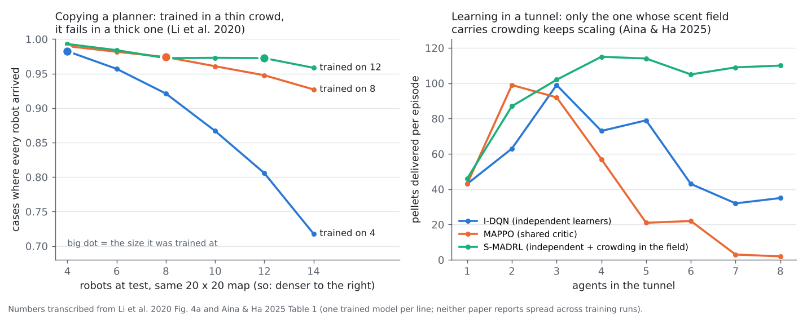

# Colony tasks: what the crowd literature adds to C1–C6

*Started 2026-10-21 by the ant-brain research lane. Status: literature and
offline analysis only, nothing built. Sent to the brain lane and the teacher
lane on 2026-10-21.*

**Why:** after the solo ladder (soil, fetch, trail), the next rungs are
colony tasks: digging rooms sized to the colony, splitting work, and keeping
a tunnel from jamming. The teacher lane has already written six colony
guidelines, C1 to C6 (`Reports/brain-training/teacher-training/guidelines-2026-10-20.md`
on branch `ccr-439ee31b-pn36yq`), on top of about 15,000 words of notes:

- `notes/evolving_collective_behaviour.md`: Waibel, Ferrante, heterogeneity,
  credit assignment, scaling;
- `notes/ant_colony_mechanisms.md`: thresholds, excavation signals, Aguilar's
  idleness;
- `notes/nest-architecture-2026-10-21.md`: Tschinkel's casts and the
  two-dimensional lab nests.

This report does not repeat them. It adds:

- four papers read in full that those notes do not cover;
- one parked experiment in `Reports/dead-ends.md` that changes how C4 should
  be built;
- four new guidelines, C7 to C10, each with its cheapest test priced.

**Tags:**

- [FT]: I read the full text.
- [ABS]: the abstract only.
- [GK]: general knowledge, not checked this session.
- *Here:* the project's own code or arithmetic.

**Dead ends checked** (grepped by mechanism, 2026-10-21):

- Dig recruitment **has an entry**, quoted in §5. It was built as a hand
  rule and parked.
- Deposition attracted to pellets (Khuong) was declined before it was built.
  The entry is at `Reports/dead-ends.md`, line 1106.
- No entry for:
  - colony size or density sweeps;
  - resting when crowded;
  - relabelling only failures;
  - scripted pioneer ants.

*Left: robots that copied a planner in a thin crowd fail in a thick one.
Training at 12 robots holds up; training at 4 does not. Right: in a
one-lane tunnel, two standard multi-agent learners fall apart above three
or four agents. The one whose shared scent field records how crowded the
tunnel is keeps delivering at eight. Numbers are transcribed from the
papers; neither reports spread across training runs.*

---

## 1. Shared genome and colony fitness: settled, and already built

**Answer:** keep one genome cloned into every ant, and score the colony.
The teacher lane's C1 and its notes (Waibel, Keller & Floreano) make the
case. The trainer already works this way: `clone_colony` puts one genome
into every ant (`src/train/challenges.rs:128`), and the colony arenas default
to 12 ants (`examples/train.rs:154`).

What the literature adds is one caution about the other side.

- **The papers that use per-agent reward say why:** to avoid diluting credit
  among agents that are *not* clones. Pitteri et al. 2026 gave each
  controlling agent "an individual step-reward" because "global rewards …
  might fail to distinguish the agents whose actions are truly responsible"
  [FT].
- **It has no force here.** With r = 1 there is no conflict to protect
  against (teacher notes, Q1). What remains is a search problem.

---

## 2. Copying a planner in a crowd: PRIMAL and the graph-network planner

**Answer:** copying works in crowds only when two conditions hold:

- the student is trained at the crowd density it will meet;
- the expert's corrections target failures, not every deviation.

Both papers below copied an optimal centralised planner into local
policies. Both paid in dense settings.

### PRIMAL: Sartoretti et al. 2019 [FT], arXiv 1809.03531

**The method.** PRIMAL mixes copying with reinforcement learning.

- In half the training episodes, agents copy the ODrM* planner by behaviour
  cloning. In the rest, they learn from reward.
- The authors varied the copying share from 10% to 50% "with little
  difference". Without copying, learning was slower and ended worse.
- A blocking penalty of −2 was needed to stop agents from parking on
  corridors that others needed. Their reading: each agent is selfish.
- Training sampled small, dense worlds on purpose, so that agents met often.

**The results.**

- PRIMAL is near-perfect with 1,024 agents in an empty 160 × 160 world.
- It gets worse as the number of agents in each one's field of view grows.
- In dense worlds where agents must move jointly, it is "easily
  outperformed": it struggles past 8 agents where ODrM* manages 64.

**For the teacher lane:**

- The copy/selection split is not a sensitive knob. PRIMAL's 10% and 50%
  did about the same, so copy-then-select needs no tuning of the share.
- In a crowd, the student's weakness is joint moves, such as two ants
  passing in a one-wide tunnel. That is the case a local copy learns worst.

### Li, Gama, Ribeiro & Prorok 2020 [FT], arXiv 1912.06095

**The method.**

- A convolutional network reads each robot's 9 × 9 view, and a graph network
  passes features to robots within 5 cells.
- It copies Conflict-Based Search on 30,000 cases per setting, in 20 × 20
  maps with 10% obstacles.

**Generalisation: the left panel of the figure.** These are Fig. 4a's
numbers. Each row is one trained model, tested at 4 to 14 robots **on the
same map**, so a bigger team is also a denser one.

| Trained on | At 4 | At 8 | At 14 |
|---|---|---|---|
| 4 robots | 0.982 | 0.921 | **0.718** |
| 8 robots | 0.990 | 0.974 | 0.927 |
| 12 robots | 0.993 | 0.972 | 0.958 |

**The authors' two reasons.** Policies trained on small teams produce
"communication topologies that are idiosyncratic", and larger teams "cause
more collisions, allowing the policy to learn how to plan more efficient
paths" [FT].

**At constant density, size does not matter.** A model trained on 10
robots ran 60 robots on a 50 × 50 map, scaled to keep density constant,
with "no degradation of performance" [FT].

**The expert corrects only failures.** Every 4 epochs, Li runs the student
on 500 training cases. For each case that hits the timeout, the expert solves
it from the point where the student got stuck, and that rescue is added to
the training data. The authors contrast this with DAgger on purpose: they
need "an explicit measure of failure (i.e., through the use of a timeout),
since focusing on any deviations from the optimal path (as in the DAgger
approach) may be misleading, because those paths may still lead to very
competitive solutions" [FT]. With this aggregation, success rose at every
team size (their Fig. 3) [FT].

**Why this matters here.** The teacher lane's DAgger arm lowered both
copies (8.64 → 6.34 and 10.57 → 9.50). Q3 §3c gave three reasons a small
student can lose under DAgger. Li adds a fourth, specific to many agents
and many good routes: a correction pulls the student off a route that was
different from the expert's but still worked. It is guideline **C9** below.

---

## 3. Learning in a jammed tunnel: Aina & Ha 2025

**Answer:** in a tunnel, the first colony problem is jamming, not
cooperation. Standard multi-agent learners fail at it from about four
agents. What fixed it was crowding written into the shared field, plus
adding agents gradually. The ant brain already has a local crowding reading
and a `Rest` option. What it lacks is a reading of how jammed the tunnel
*ahead* is.

**The task** (Aina & Ha 2025 [FT], arXiv 2510.03592; Aina's earlier work is with
Goldman, whose lab ran Aguilar et al. 2018). This is the robot version of Aguilar's
fire-ant tunnels.

- Agents walk down a one-lane tunnel to a pellet face, dig, and carry
  pellets home.
- Each agent is an independent deep-Q learner with five moves: four
  directions and stop.
- Agents lay a virtual pheromone that decays and is reinforced. It records
  occupancy and whether the agent is laden.
- The field also carries the tunnel's density, ρ = n/L.

**Results** (Table 1, the right panel). These are pellets delivered per
episode.

| Agents | 1 | 2 | 3 | 4 | 5 | 6 | 7 | 8 |
|---|---|---|---|---|---|---|---|---|
| I-DQN (independent learners) | 43 | 63 | 99 | 73 | 79 | 43 | 32 | 35 |
| MAPPO (centralised critic) | 43 | 99 | 92 | 57 | 21 | 22 | 3 | 2 |
| S-MADRL (independent learners plus the field) | 46 | 87 | 102 | **115** | 114 | 105 | 109 | 110 |

**The authors' explanation.** They name the density term as "a key driver
of this scalability". It lets agents "switch between active mode (entering
the tunnel) and passive mode (remaining idle at home)" [FT].

**Two further findings.**

- **Without the field, agents clog; with the field but no curriculum, five
  agents still clog.** The curriculum trains the agents "sequentially, focusing
  on one agent at a time". With it, "some agents strategically remain idle" [FT].
- **Workload became unequal as the team grew.** At four or more agents the
  Lorenz curves bow away from equality, more so with the curriculum. That is
  Aguilar's finding in fire ants, reached by learning [FT].

**Caveats.**

- Each cell of the table is one number, with no seeds or spread reported.
- The density term is a count over the whole tunnel. It is handed to the
  agents, not sensed locally.

**What the ant already has** (*here*):

- `c::CROWD`: animals touching the head (`src/sim/creature/mind.rs:100`).
- `f::CROWD`: animals beside each option's cell.
- `f::ROOM`: open cells per animal in the 5 × 5 around it
  (`src/sim/creature/options.rs:610–626`).
- `Rest`: a verb (`options.rs:78`).

So the local ingredients for "wait when the way is blocked" are wired.

**What it does not have** is Aina & Ha's tunnel-wide count. The local
stand-in is an encounter rate: how often the ant has touched others
recently. That is Gordon's mechanism, which C5 already names for foraging.
A memory unit can integrate `c::CROWD` into one, and Q5 asks whether real
ants do this in tunnels. It is guideline **C8** below.

---

## 4. A few agents steering a colony through scent: Pitteri et al. 2026

**Answer:** C5 says no study was found that teaches through a shared field
like scent. That is still true for *copying*. For *steering*, this paper is
direct evidence: a 10% minority, acting only through pheromone, moved a
whole colony from disorder into trails. That suggests a teacher that works
inside the world rather than through labels.

**The setup** (Pitteri, Guizzo, Ferrarotti, Lepri & Gallotti 2026 [FT],
arXiv 2607.17709).

- 300 rule-following model ants in a classic ant-swarm model: they deposit
  pheromone at a constant rate and turn toward it, with noise.
- 30 "smart agents" look the same, but lay pheromone at 10 times the ants'
  rate and move by a shared policy learned with PPO.
- The smart agents interact with the ants only through the field.

**Results.**

- Where the ants alone stay disordered, the smart agents produce trails.
  At the training setting (δ = 0.3, β = 4.5), the order parameters went from
  m = 0.19 and M = 0.29 to m = 0.99 and M = 0.92. Here m measures how
  concentrated the pheromone is, and M how many ants stand on it.
- A policy trained at that one setting generalised across the phase diagram.
- **The extra scent alone was not enough.** Letting some agents release more
  pheromone "can induce global ordering, [but] does not generate stable and
  well-structured trails"; the learned *movement* mattered [FT].
- **The effect is not linear in the number of smart agents.** Below a
  minimum fraction they do nothing, and above a threshold they saturate [FT].

**For this project.** This is control of fixed-rule ants, not training of
learners, so the step to here is an inference.

- A training world could hold one or two **pioneer ants** driven by the
  planner, laying trail scent. The other ants carry the evolving genome and
  are selected on the colony score.
- Selection would then only need to find "follow the trail", not "invent
  the trail". Ferrante's lesson in the teacher notes points the same way:
  evolve the allocation, not the building blocks.
- **The danger is a crutch.** A genome that only works beside a pioneer is
  useless in the game. So the pioneers must fade out, the way Q3's coaching
  schedule fades the teacher, and the acceptance test runs without them.

**Aside, outside this brief:** if the gnome could lay trail scent, this
result says a few scent-layers can steer a colony, which would give the
player a verb over the ants (`CLAUDE.md`, "there must be a verb").

This is guideline **C10** below. It ranks last: it needs a scripted ant
class, and the crutch risk is real.

---

## 5. Nest size from recruitment: Buhl 2005, and the parked experiment

**Answer:** the mechanism works on digging in this engine already, but as a
hand rule it shrank the colony. The building scent already planned for the
dig rung is the right channel: a scent the genome lays, with a sense that
reads it, kept or dropped by selection on the colony score. C4's acceptance
test (N against 2N) is the bar.

**What Buhl adds to C4.** Buhl, Deneubourg, Grimal & Theraulaz 2005 [ABS]
(*Behav Ecol Sociobiol* 58:9–17) found:

- *Messor sancta* groups dig on a logistic curve;
- the final volume is nearly proportional to the number of workers;
- a model whose only feedback is **pheromone recruitment** reproduces both
  the saturation and the linear volume–N relation, with no explicit
  negative feedback.

Buhl's thesis abstract gives the brake: a balance between amplified digging
and the extension of the gallery network [ABS]. As the tunnels branch, the
same recruitment is spread over more faces. **No ant measures density.**

So two different brakes can each size a nest:

- **crowding at the face:** C4's teacher rule, after Toffin;
- **recruitment diluted over more faces:** Buhl.

They predict different things. Under dilution, nest size per ant depends on
how fast the dig scent decays. Under crowding it does not. If a building
scent ships with a decay constant, sweeping it tells the two apart.

**The parked experiment** (`Reports/dead-ends.md`, line 1274). Lane 20
built `PIXEL_PHYSICS_FRESH_CUT=recruit*` on 2026-10-03, a hand rule that
sends diggers back to where nestmates just dug, citing Buhl 2004. It was
measured on 12 paired seeds to 40k frames:

- the dug home was bigger on **12 of 12** seeds, and per live ant on 11 of
  12 (3.99 against 2.06);
- **but** there were 26 live ants against 37, and 20.5 births against 32.

The entry's re-test condition: "ants live deep in the nest and the colony
holds to 300k. Build it beside a local crowding signal, so the recruit
follows the crowd and not a colony count."

**What that means for the brain.** A hand rule cannot weigh digging against
feeding the brood. A genome under the colony score with the energy tax can.
It keeps recruitment only where the colony as a whole gains. The pieces are
half-wired (*here*):

- the brain has an input for the building scent, `f::BUILDING`, listed as
  `UNWRITTEN` (`mind.rs:846–850`);
- the emit comments say "the building scent comes later, with the dig rung"
  (`mind.rs:64–65`).

Build that scent with `f::CROWD` and `f::ROOM` beside it, as the dead-end
asks.

**Bar.** Halley et al. 2005 [ABS] found that 1,000-worker colonies dug less
than ten times what 100-worker colonies dug. Römer & Roces 2015 [ABS] found
that leaf-cutter workers over-dig and then refill. So the bar is C4's
"grows clearly with N", not a ratio, as C4 already says.

---

## 6. Four guidelines past C1–C6

### C7. Match how many neighbours each ant has, not how many ants there are

**Evidence:**

- Li 2020 [FT]: a model trained at 4 robots on a fixed map fell to 0.72 at
  14; one trained at 12 held 0.96 (§2). At constant density, 10 → 60 robots
  cost nothing.
- PRIMAL [FT]: performance falls with the number of agents in view.
- This turns C6's "train small, vary the size" into a sharper rule. What
  must match between training and the game is **contacts per ant**. Below
  some density the student never meets the hard cases.

**What it changes:** C6's "small N" is safe only if the arena is also
small. Twelve ants in today's 256 × 128 bed can be thinner than a colony in
a dug nest. Ferrante's 4 → 20 transfer fits this: the arena was "scaled
proportionally" with the robots (teacher notes, Q6).

**Cheapest test** (*here*):

1. Run the s171 genome on the trail arena (6 ants by default) at `ants=` 3,
   6, 12 and 24, at 48 worlds each.
2. Log per-ant trail output, and the mean of `c::CROWD` per ant per frame.

- **Cost:** about 200 world-runs, a few core-minutes each at most. Under
  half a core-hour in total, if 24 ants cost no more than 4 times a 6-ant
  world. Price one 24-ant world first.
- **Reading:** if per-ant output falls as `c::CROWD` rises, the colony rungs
  must be trained at the game's contact rate, not at a convenient N.
- **The specificity control:** if per-ant output is flat, the trail arena
  is not yet crowded enough to matter, and C6 stands as written.

### C8. In a tunnel, the brain must be able to wait, and must sense when to

**Evidence:**

- Aina & Ha 2025 [FT]: standard learners collapse past 3–4 agents in a
  one-lane tunnel, and the fix was a crowding reading in the field plus
  adding agents gradually (§3).
- Aguilar et al. 2018 (in the teacher notes): fire ants solve the same
  problem by idling and retreating.
- The brain has `Rest`, `c::CROWD`, `f::CROWD` and `f::ROOM` already.

**What it changes:**

- Before the first tunnel rung, check that the current brain *uses* `Rest`
  when the way ahead is blocked. A brain that never waits will clog any
  narrow arena, whatever the fitness says. Unequal work is then the
  expected sign of success, not a defect to train away.
- If it does not wait, and the cause is that `c::CROWD` reads only touch,
  the missing input is a recent-encounter rate (Q5). It is not a bigger
  brain.

**Cheapest test** (*here*):

1. Trace one existing 12-ant dig or forage champion over 12 worlds. No
   training is needed.
2. For each decision, log whether `Rest` was chosen, plus `f::CROWD` and
   `f::ROOM` of the best `Walk` option.
3. Plot P(Rest) against crowding ahead.

- **Cost:** about 12 world-runs, a few core-minutes. Under 0.1 core-hours.
- **The positive control:** the same trace in a world with a one-wide shaft
  and 12 ants, where jams are guaranteed.

### C9. When the teacher corrects a crowd, correct only the failures

**Evidence:**

- Li 2020 [FT]: the expert rescues timed-out cases and leaves working
  deviations alone, because correcting deviations "may be misleading" when
  many routes are good (§2). It raised success at every team size.
- The teacher lane's DAgger arm hurt both copies.

**What it changes:** a DAgger round relabels only the states of trips that
**failed**, and only from the point where they failed:

- a loaded ant that did not get home within the window;
- an ant stuck for N frames;
- cargo dropped outside the nest.

States on trips that worked keep their original labels, even where the
planner would have chosen differently.

**Cheapest test:** the teacher lane's own DAgger arm, rerun with the
relabel set restricted to failed trips.

- **Cost:** one offline copier run plus one 48-world evaluation. About the
  same as the arm that lowered the copies, a few core-minutes on top of the
  copier.
- **Reading:** against the 8.64 and 10.57 baselines and the 6.34 and 9.50
  DAgger results. If the restricted arm lands at or above the baseline,
  Li's explanation holds here.
- **Not a crowd test.** The two copies are solo, so a pass tests Li's
  reasoning (good but different routes), not crowds.

### C10. A teacher can work inside the world: pioneer ants that fade

**Evidence:** Pitteri et al. 2026 [FT]. A 10% minority moving by a learned
policy shifted a colony into trails through scent alone, and extra scent
without the learned movement did not (§4).

**What it changes:** where a colony skill cannot be copied through labels
(C5's gap), put the planner in the world. One or two planner-driven ants lay
the scent, and selection finds the genome that follows. Fade them out over
generations, and accept only genomes that keep the skill without them.

**Cheapest test:**

- **Build:** a scripted-brain ant in the trainer. That is new code, and
  `src/train/` belongs to the brain lane.
- **Run:** a paired run on the trail arena, with and without pioneers in
  the early generations. Both arms are scored without pioneers at the end.
- **Cost:** about 50–100 core-hours, $0.70–1.40 at $0.014 per vCPU-hour.
  Rank it last.

---

## Ranked list for Q4, cheapest decisive test first

| Rank | Test | What it decides | Cost | Owner |
|---|---|---|---|---|
| 1 | **C8 trace**: P(Rest) against crowding ahead, current 12-ant champion, plus a one-wide-shaft positive control | Whether the brain already waits when blocked: the precondition for any tunnel rung | < 0.1 core-hours; trace only | Brain lane |
| 2 | **C7 sweep**: s171 on trail at `ants=` 3, 6, 12, 24, logging per-ant output and mean `c::CROWD` | Whether colony rungs must be trained at the game's contact rate rather than a convenient N | < 0.5 core-hours | Brain lane |
| 3 | **C9 arm**: DAgger relabel restricted to failed trips | Whether DAgger hurt because it corrected working deviations (Li's reason) | A few core-minutes on top of the copier | Teacher lane |
| 4 | **Building scent** with crowding beside it, accepted by C4's N against 2N | Whether selection keeps recruitment where the hand rule shrank the colony | Engine work, then one Google run, about $1 | Brain lane |
| 5 | **Brake discrimination**: sweep the building scent's decay | Whether nest size comes from crowding (decay-blind) or from recruitment dilution (decay-sensitive) | Rides on rank 4; about 1 core-hour of evaluation | Brain lane |
| 6 | **C10 pioneers**, fading, scored without them | Whether an in-world teacher speeds up a colony skill without becoming a crutch | New trainer code, then 50–100 core-hours | Brain and teacher lanes |

**Not recommended for now:**

- **Separate genomes per ant or per caste.** C1 and the teacher notes cover
  this: clonal colony scoring already removes the altruism problem. A caste
  bit fed to one genome covers castes if they are ever wanted.
- **Graph-network messages between ants** (Li, Tolstaya). They work, but
  through explicit radio links that an ant does not have. Senses must stay
  local and true to the biology.
- **Gradient multi-agent methods** (MAPPO, QMIX, COMA). The teacher notes
  (Q5) cover what transfers. Aina & Ha's table shows MAPPO collapsing in the
  very setting the colony rungs will hit.

## Sources

- Sartoretti, G. et al. (2019). PRIMAL: Pathfinding via Reinforcement and
  Imitation Multi-Agent Learning. *IEEE RA-L* 4:2378–2385. arXiv 1809.03531
  [FT]
- Li, Q., Gama, F., Ribeiro, A. & Prorok, A. (2020). Graph Neural Networks
  for Decentralized Multi-Robot Path Planning. *IROS 2020*. arXiv 1912.06095
  [FT]
- Aina, K. O. & Ha, S. (2025). Deep Reinforcement Learning for Multi-Agent
  Coordination. arXiv 2510.03592 [FT]
- Pitteri, A., Guizzo, A., Ferrarotti, L., Lepri, B. & Gallotti, R. (2026).
  Ant swarm functional control via stigmergic Reinforcement Learning agents.
  arXiv 2607.17709 [FT]
- Buhl, J., Deneubourg, J.-L., Grimal, A. & Theraulaz, G. (2005).
  *Behav Ecol Sociobiol* 58:9–17. doi:10.1007/s00265-004-0906-2 [ABS]
- Halley, J. D., Burd, M. & Wells, P. (2005). *Insectes Sociaux*.
  doi:10.1007/s00040-005-0818-9 (*Linepithema humile*, 10, 100 and 1,000
  workers) [ABS]
- Römer, D. & Roces, F. (2015). *Insectes Sociaux*.
  doi:10.1007/s00040-015-0419-1 (*Acromyrmex lundi*) [ABS]
- Aguilar, J. et al. (2018). Collective clog control. *Science*
  361:672–677, via the teacher lane's notes.
