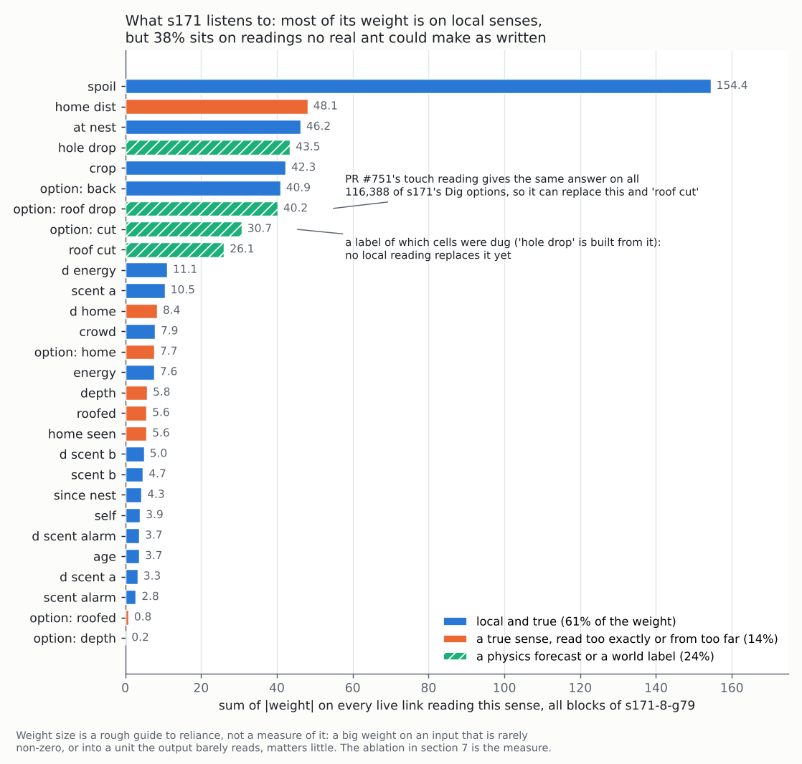

# Real ant sensing: which of the ant's senses are true, and what replaces the rest

*Started 2026-10-21 by the ant-brain research lane. Status: literature and
offline analysis only, nothing built. Sent to the brain lane and the teacher
lane on 2026-10-21.*

**Why:** the owner's rule is that the ant's senses stay local and true to
the biology. This report checks every sense the brain reads against that
rule, using the code and the weights of the current champion, s171. For each sense
that fails the rule, it asks what a real ant uses instead and what the swap
would cost here.

The teacher lane's notes (on `main` since PR #753, under
`Reports/brain-training/teacher-training/`) already cover body pitch from
*Pheidole oxyops* reading its mound, headroom over the ant's own head as a
candidate sense, encounter rate with laden nestmates after Gordon, backfill,
tunnel width, the chamber heights of real nests, and their gap M7: no paper
gives a *digging* mechanism for constant chamber height.

This report does not repeat those. It adds a sense-by-sense audit against
s171's weights, the 2013 test that refuted the CO2 depth template, the
receptor literature behind the remaining senses, a conflict between true
chamber height and the owner's spec, and seven priced tests.

**Tags:**

- [FT]: I read the full text.
- [ABS]: the abstract only.
- [GK]: general knowledge, not checked this session.
- *Here:* the project's own code or arithmetic.

**Dead ends checked** (grepped by mechanism, 2026-10-21):

- **The trail sense** has three entries (lines 1058–1060, 2077, 2079),
  quoted in §6.
- **`under_cover` as a gate on dropping spoil** failed (line 1105). That is
  the gate, not the sense, and §3 keeps the sense.
- **The dig-recruit hand rule** is parked at line 1274. §4 supplies the
  crowding signal its re-test condition asks for.
- **No entry for** CO2, quorum, a contact-rate sense, a noisy home vector,
  Weber-law scent reading, or chamber height by reach. The one `odometer`
  entry (line 2065) is a different mechanism.

*Where the current champion's weight sits, sense by sense: the sum of
|weight| over every live link that reads the sense, in all five blocks of
`training/starts/s171-8-g79.txt`. Blue senses are local and true. Orange
senses are true but read too exactly or from too far away. Hatched green
senses are a physics forecast or a world label. Weight is a rough guide to
reliance, not a measure of it. The ablations in the ranked list are the
measure.*

---

## 0. The answer in short

- **Most of the brain is already honest.** 61% of s171's sense weight is on
  local, true readings, 24% on a forecast or a label, and 14% on true senses
  read too exactly (*here*).
- **The roof forecast, the biggest dishonest reading, is the easiest to
  fix.** PR #751's touch bit agrees with it on all 116,388 of s171's Dig
  options, and the owner approved the swap. Real ants also avoid loaded
  grains by a local cue rather than by sensing the force network (§5).
- **Depth has no known true sense, and s171 barely uses it.** The CO2
  template was refuted in 2013 (§3). An ablation decides whether to drop it.
- **The home vector is true but far too exact.** Real error grows with the
  vector's length (§2). A noisy vector would put a search for home on
  screen. Whether that is fun is the owner's call.
- **Ants count meetings per minute, not heads**, and the switch comes at the
  same rate in any nest size (§4). A contact-rate sense is the crowding
  signal the parked dig-recruit rule's re-test condition asks for.
- **The trail sense already matches the biology.** Weber's form is the one
  untried variant, worth it only if trails fail far from the nest (§6).
- **True chamber height and the owner's spec differ about four-fold** (2–4
  cells against 8–16). A height sense at today's 6-cell reach cannot see a
  spec chamber (§7).

## 1. The audit

Every sense the brain reads, from `src/sim/creature/mind.rs` (the context
senses `c::`) and `src/sim/creature/options.rs` (the option features `f::`).
The weight column is s171's sum of |weight| from the picture.

| Sense | What it reads (*here*) | True to an ant? | s171 weight |
|---|---|---|---|
| `energy`, `d_energy`, `crop`, `spoil` | Body state | **Yes.** Internal | 7.6, 11.1, 42.3, 154.4 |
| `age` | Frames since birth | **Yes.** Age sets where a worker sits and how it digs (§3) | 3.7 |
| `since_nest` | Ticks since last at the nest | **Yes.** Atta queens judge tunnel length by proprioception plus digging time (Fröhle 2009 [ABS]) | 4.3 |
| `self` | A fixed per-ant random number | **Yes.** It stands for individual variation | 3.9 |
| `at_nest` | A nest cell next to the head | **Yes.** Touch or smell | 46.2 |
| `scent` ×3, `d_scent` ×3 | Smell at the head, and its change since the last tick | **Yes.** Antennae | 2.8–10.5 each |
| `crowd` | Animals touching the head, /8, this tick | **Yes, but instantaneous.** Ants use a rate (§4) | 7.9 |
| `home_seen`, `home_dist`, `d_home`, `f::HOME` | The exact Euclidean vector to `forage_anchor` | **A true sense, read too exactly** (§2) | 5.6, 48.1, 8.4, 7.7 |
| `depth`, `f::DEPTH` | Rows below the founding ground surface at this column (`depth_at`, `mind.rs:1224`) | **No.** A map datum, and no depth sense is known (§3) | 5.8, 0.2 |
| `roofed`, `f::ROOFED` | Ground anywhere in the 20 rows above (`COVER_REACH`) | **A fair stand-in for darkness** (§3) | 5.6, 0.8 |
| `roof_cut`, `f::ROOF_DROP` | A physics forecast: would this cut drop the roof? | **No.** But #751's touch reading gives the same answer (§5) | 26.1, 40.2 |
| `hole_drop`, `f::CUT` | `World::dug_cells`: was this cell dug by ants? | **No.** A label, with no stand-in measured yet (§5) | 43.5, 30.7 |
| `f::HEADROOM` | Open cells above the *option's* cell, up to 6 | **Wrong as used**, as the teacher lane found; and too short for the spec (§7) | 1.8 |
| `f::HARD`, `f::WET`, `f::WARMTH` | The soil at the face | **Yes.** Digging rate rises with soil temperature and moisture (Mikheyev & Tschinkel 2004 [ABS]) | 0.6, 3.7, 0.1 |
| `f::UP`, `STAND`, `FALL`, `CLIMB`, `DROP_BELOW` | Gravity and footing | **Yes.** Gravity is sensed (§3). The drop below reaches 6 cells, about 3 body lengths | 0.3–8.6 |
| `f::BACK` | The option undoes the last step | **Yes.** A one-step memory | 40.9 |
| `f::CROWD`, `f::ROOM`, kin features | Animals near the option's cell | **Yes.** Antennal contact. The 5×5 `ROOM` reaches a little over one body length past the head | 0.4–3.5 |

Two things stand out (*here*):

- **The dug-cell labels outweigh the home vector**: `hole_drop` and
  `f::CUT` hold 74, against 70 for all four home readings. The roof
  forecast holds 66 more.
- **Depth and roofed are nearly unused**: 12 of 575. So changing them should
  be cheap, and the ablation (rank 2) should prove it first.

## 2. The home vector: true, but far too exact

**What the biology says:**

- **Path integration is built-in anatomy, not learning.** In the bee,
  compass neurons and optic-flow speed neurons converge in the central
  complex, where Stone et al. 2017 [ABS] found candidate integrator cells
  and proposed a full circuit for integrating and steering.
- **The error grows with distance.** Longer trips give larger errors, and
  ants widen their nest search to match (Merkle, Knaden & Wehner 2006
  [ABS]). The search width follows the home vector's length, not how
  winding the outbound path was (Merkle & Wehner 2010 [ABS]). Distance is
  underestimated, more so for longer trips (Sommer & Wehner 2004 [ABS]).
- **When the vector runs out, the ant searches** in loops of growing size
  around where it believes the nest is (Müller & Wehner 1994 [ABS]).
- **It works in the horizontal plane only**, counting ground distance over
  hills (Ronacher 2020 [ABS]).
- **The vector gates local cues.** Homing ants follow the nest's odour
  plume, CO2 among it, only when their integrator says home is near
  (Buehlmann, Hansson & Knaden 2012 [ABS]). Trail pheromone serves as
  reassurance and fail-safe (Freas, Buehlmann & Spetch 2026 [ABS]).

**Here:**

- `c::HOME_DIST` is `squash(dist / 32)` on the exact distance to
  `forage_anchor` (`mind.rs:1495`). `f::HOME` is the exact cosine.
- The world has a blind switch (`World::home_blind`) for the trainer's
  control layouts. That already gives the far end of any noise sweep.
- In s171, `home_dist` is the second-heaviest sense (48.1), mostly through
  one hidden unit (40.2).

**What to do:**

- **Keep path integration as a built-in sense.** Evolving it from a compass
  would cost a great deal and show nothing. The insect does not learn it
  either.
- **Make it noisy the way real ants are** (*here*, a proposal). Each trip,
  draw a seeded offset with spread *k* times the home vector's length, and
  redraw it at the nest. The ant reads home as `anchor + offset`. Runs stay
  deterministic, it does not jitter tick to tick, and the error scales with
  distance as Merkle & Wehner 2010 found. No paper gives a *k* that
  transfers to a pixel ant, so sweep 0, 0.05, 0.1 and 0.2.
- **The gain:** a lost ant would search in widening loops near the nest, and
  the trail and nest smell would matter on the way home.
- **The risk:** fetch is a floor, and every rung that pays a homing trip
  would need scoring again.
- **So it is a game-feel decision for the owner**, made on a paired GIF at
  *k* = 0 and 0.1 plus the fetch score at each *k* (rank 5).

## 3. Up, down and depth

**Gravity is a true sense, though its receptor is still argued over:**

- Hair-plate fields at the neck, petiole, gaster and leg joints act as
  gravity organs (Markl 1962 [ABS]). Johnston's organ in the antenna is
  probably another (Vowles 1954 [ABS]).
- *Formica lemani* digs upward in darkness, and loses the orientation when
  the dish is rotated (Sudd 1972 [ABS]). *Lasius niger* on inclines
  combines klinokinesis with geomenotaxis (Khuong et al. 2013 [ABS]).
- Yet immobilising the neck and petiole hair fields did *not* impair path
  integration over hills (Wittlinger, Wolf & Wehner 2007 [ABS]). The slope
  sensor is still unknown (Ronacher 2020 [ABS]).

So `f::UP`, `STAND`, `FALL` and `CLIMB` pass the rule, and the teacher
lane's body pitch is supported by the behaviour. The receptor need not be
modelled: in a pixel world the pitch is the slope of the cells underfoot.

**Age changes how an ant digs, and the brain already has age:**

- Younger *Camponotus fellah* dig slanted tunnels and older ones dig
  straight down; in a growing colony the young do most of the digging
  (Rajendran, Weinberger, Fonio & Feinerman 2026, *eLife* [ABS]).
- `c::AGE` is already in the context (s171: 3.7), so there is nothing to
  build. One note for the dig ladder's scores: a slanted shaft is a true
  shape, so do not punish it for not being vertical.

**Depth has no known true sense.**

- *Here:* `depth_at` reads how far the ant is below the ground surface its
  column had at founding. Nothing an ant digs later moves that datum. It is
  map knowledge.
- **CO2 was proposed as the depth template and refuted.** Tschinkel 2004
  [ABS] found CO2 rising five-fold down *P. badius* nests and proposed it.
  Tschinkel 2013 [ABS] then vented the gradient away around colonies
  starting a new nest, and in a stronger test reversed it. Neither changed
  the new nests: "the soil carbon dioxide gradient does not serve as a
  template for nest construction or vertical worker distribution". Yet
  colonies rebuild a matching nest within a week, which "requires that they
  have information about the depth below ground". So the cue exists and is
  unknown.
- **The remaining candidates are soil temperature and moisture.** Both
  change how fast ants dig (Mikheyev & Tschinkel 2004 [ABS]; Roces &
  Bollazzi 2025, review [ABS]). The world already offers `f::WARMTH` and
  `f::WET` at each option.
- **s171 barely uses depth** (5.8, and 0.2 for `f::DEPTH`).

**Recommendation:** run the ablation first (rank 2). If zeroing depth costs
nothing on dig and fetch, leave it out of the next genome's context. If it
costs something, keep it, and say in its doc that it is a game convenience
with no known biological reading. Do not build a CO2 field to justify it.

**Roofed is a fair abstraction of darkness.** It asks whether there is
ground in the 20 rows above (about 10 body lengths), which no ant reads by
touch, though it does feel darkness. The light field is coarse (one value
per field block, a limit dead-ends line 1104 names) and carries the
day/night cycle. So keep `roofed`, labelled "darkness, abstracted".

## 4. Encounter rate: meetings per minute, not heads

**What the biology says:**

- **A quorum is a rate of contacts.** *Temnothorax* scouts sense a quorum
  by the rate of direct encounters (Pratt 2005, *Behav Ecol* [ABS]).
  Blocking contact makes ants act as if the nest were empty. In a smaller
  nest the switch comes at a lower population but the same encounter rate.
  Detection takes about two minutes. It needs direct contact (Pratt 2005,
  *Insectes Soc* [ABS]).
- **Collision frequency alone can regulate digging.** Fire ants in
  quasi-2D arenas dig in three stages (Avinery et al. 2023 [ABS]). A
  cellular-automaton model reproduces the stages. In it, each ant estimates
  its own collision frequency and is "agitated": it avoids resting when
  collisions are frequent.
- **Nest volume tracks population**, with digging as the negative
  feedback, and a nest given extra ants is enlarged the same way (Rasse &
  Deneubourg 2001 [ABS]). Gordon's foraging rate, set by contacts with
  laden returners, is in the teacher notes.

**Here:**

- `c::CROWD`, `f::CROWD` and `f::ROOM` are counts at this tick. Nothing
  integrates them unless the brain builds it.
- **s171 has started to.** Memory unit 6 runs at the slowest rate (0.995).
  It takes `crowd` at +0.70, but mixed with the change in scent A (+0.89),
  `home_seen` (+0.61) and memory 3 (−0.78). The scorer reads unit 6 at only
  3.1 in total. That is a slow unit that half listens to contact, not an
  encounter meter.

**Why a clean rate would matter here:**

- **Pratt's size-invariance is what a dig stop needs.** A threshold on
  contact rate scales with the nest by itself: more room, fewer meetings,
  less digging.
- **It is the signal the parked dig-recruit rule asked for.** That rule
  grew the home on 12 of 12 seeds but shrank the colony (26 live ants
  against 37), and its re-test condition reads "build it beside a local
  crowding signal" (dead-ends line 1274). Q4's C8 test, whether the brain
  waits when blocked, needs it too.

**What to do:** probe the current champion first (rank 4): does any memory
unit read `crowd` at a rate of 0.95 or more, and is it read downstream? If
no clean unit has formed, add a built-in leaky contact rate as a context
sense, with a laden-contacts variant for Gordon's mechanism. The time
constant is a project choice, near Pratt's two minutes in game ticks.

## 5. Touch and soil: the roof by touch, and the dug-cell label

**The roof.** PR #751 found that a present-tense touch bit gives the same
answer as the `f::ROOF_DROP` forecast on all 116,388 of s171's Dig options
over 48 soil-arena worlds. The bit reads: "a grain beside the bite rests on
it or on air and has two or fewer other grains holding it, or a pellet rests
on it". The owner approved the swap. The literature gives it a mechanism:

- **Ants avoid loaded grains without measuring load.** Real-time X-ray CT
  of *Pogonomyrmex* tunnelling (Buarque de Macedo et al. 2021 [ABS]) found
  that forces between grains fall around tunnels, because arches form. So
  any grain picked from the tunnel surface is likely to be under low
  stress.
- **Ants sense the geomechanical conditions at the face**, and adapt to
  them (Espinoza & Santamarina 2010 [ABS]).
- **Pellet size stays similar across substrates**, while tunnel depth
  tracks cohesive strength (Monaenkova et al. 2015 [ABS]).

#751's bit is the pixel form of the same idea: the ant feels whether its
bite holds a neighbour that little else holds. #751 also found the existing
44 features predict the flag at AUC 0.994, and `f::LINED` alone at 1.000.
So the information was already local. Swapping the bit in is rank 1.

**The dug-cell label is the larger problem.** `f::CUT` reads
`World::dug_cells`, and `c::HOLE_DROP` is built from it (`mind.rs`,
`hole_drop`). Together they are s171's second-heaviest reading, at 74. No
ant can know that a cell of air was opened by its colony rather than by
nature.

Real ants tell a nest from outside by darkness, touchable walls and the
colony's smell on them [GK]. The world has two of those locally: `f::LINED`
and `roofed`. So the first step is #751's method (rank 3): over s171's Drop
options, count how often `f::CUT` agrees with "a lined wall in reach, under
cover". Near-total agreement makes the swap free; the disagreements show
what the label knows that touch cannot.

## 6. Pheromone gradients and the two antennae

**What the biology says:**

- **Argentine ants turn in response to local concentration only**, in
  about a 1 cm radius in front of the ant. They do not integrate over time.
  The turn follows Weber's law: the difference between the two sides
  divided by their sum (Perna et al. 2012 [ABS]).
- **Carpenter ants sweep their two antennae in opposition.** When
  following a trail they use both to find its edges, a specialised
  tropotaxis. Removing one antenna makes tracking less accurate (McGill,
  Kapoor & Murthy 2018, bioRxiv [ABS]).

**Here:**

- Each option carries its own scent, plus the difference from the head's
  cell and the difference two cells further. The differences use a fixed
  gain of 32 (`SCENT_GAIN`, `options.rs:313`).
- The scorer sees the options side by side in a single tick, so it is
  already comparing left with right with no time integration. That is the
  form Perna found.
- **Two variants were tried on the older brain and failed.** Wiring the
  rising-scent reading under the feet (a reading over time) into `Move`
  tethered empty ants to the nest (dead-ends line 2079). A two-forward-sample
  comparator changed the reading but nothing downstream (line 2077).
- **Weber's form is untried** ("Weber" does not appear in dead-ends).
  Channel A is a ramp, brightest at the nest, so far out its slopes are
  small in absolute terms and read small at a fixed gain. Weber's form reads
  the relative change, so a faint trail reads as clearly as a strong one.
- **Run it only if the trail rung fails far from the nest.** Measure that
  first (rank 7). Beetles once failed on a thin trail (line 1058). That
  failure came from reading only two points six cells apart. The options
  read every neighbouring cell.

## 7. Constant chamber height

The teacher lane's M7 stands: no paper gives a *digging* mechanism for
constant chamber height, and this search found none either. What is known:

- *P. badius* chambers are about 1 cm tall at every floor area. They start
  as horizontal-floored niches on the outside of the shaft's helix and grow
  by lobes (Tschinkel 2004 [ABS]).
- In *F. pallidefulva*, chambers are formed in the direction of the
  tunnels leading up to them (Mikheyev & Tschinkel 2004 [ABS]).
- *Acromyrmex* workers trim chambers back with pellets to a width where two
  ants can pass (Fröhle 2009 [ABS]).
- Relocated brood triggers chamber excavation (Römer & Roces 2014 [ABS]).

**A mechanism that fits (*here*, a hypothesis):** a reach template. A
worker on the floor bites the face in front of its head and cannot reach a
roof much above a body height, so the floor moves outward and the roof stays.
This world's jaws already reach only the head's eight neighbours, so a
two-cell ant on the floor bites at most two rows up. The roof rises only
when an ant digs from a wall or a spoil heap.

**The conflict:**

- **Real chambers are 1 to 2 body lengths tall**: 2 to 4 cells at the
  teacher lane's scale of 1 BL = 2 cells (`ant.ron`: `body: Chain(2)`).
- **The owner's spec is 8 to 16 cells** (2026-09-20, printed by
  `examples/digbox.rs`, used by steps 10–11 of `dig-rung-design.md`). That
  is about four times real, so a true reach template cannot hold it.
- **The spec is a ruling on what reads on screen, so it stands.** What it
  changes is how a height sense must be built. `f::HEADROOM` counts open
  cells only up to `REACH = 6` (`options.rs:582`), so a headroom-over-the-head
  sense built at that reach reads 1.0 in every room taller than 6. It cannot
  tell 7 from 16. **It needs a reach of at least 17**, one past the spec's
  top. `COVER_REACH` is already 20, so the column scan exists. It would be a
  non-local game concession, like `roofed`, and its doc should say so.
- If the owner ever wants true-scale chambers, the jaws' reach should give
  them with no new sense.

## 8. Backfill and the slope of the mound

These are covered in the teacher notes: Halfen & Hasiotis's 51% of spoil
kept inside as backfill, Tschinkel's casts, and *Pheidole oxyops* dropping
where the mound's slope turns. The spoil roll that landed in PR #753 (off by
default) is the physics half of the *Dorymyrmex* story. Nothing to add.

---

## Ranked list for Q5, cheapest decisive test first

| Rank | Test | What it decides | Cost | Owner |
|---|---|---|---|---|
| 1 | **Ship #751's touch bit for `f::ROOF_DROP`**, then score s171 on the soil and dig rungs, 48 worlds each | That the honest roof sense leaves the champion's scores unchanged. Approved; this is the check | ~2 core-min | Brain lane |
| 2 | **Depth and roofed ablation**: zero every link reading `c::DEPTH` and `f::DEPTH` (then `roofed`) in s171; score on dig and fetch, 48 worlds | Whether depth can leave the next genome's context. A genome edit, no code | ~1 core-min per arm per rung, ~8 in all | Brain lane |
| 3 | **Dug-label census**, #751's method: over s171's Drop options, agreement of `f::CUT` with "lined wall in reach and roofed" | Whether the label can become touch for free, or what touch misses | A small probe, then minutes of CPU | Brain lane |
| 4 | **Encounter-meter probe** on the current champion: memory units reading `crowd` at rate ≥ 0.95, and their downstream weight | Whether selection already builds a contact rate, or a built-in one is needed before C4's building scent | Genome inspection, seconds. s171 done here: no clean meter | Brain lane |
| 5 | **Noisy home vector**, *k* = 0, 0.05, 0.1, 0.2: fetch and dig scores, plus a paired GIF at *k* = 0 and 0.1 | Whether a truer home vector costs the fetch floor, and whether the search loops are fun | Code in `mind.rs`/`options.rs`, then ~8 core-min, plus the owner's look | Brain lane; owner decides |
| 6 | **Height sense reach ≥ 17**, if the teacher lane builds headroom over the head | That the sense can see the spec chamber at all | Zero: a design note | Teacher lane |
| 7 | **Trail slope by distance from nest**: |scent difference| on the chosen option against distance from the nest, on the trail rung | Whether Weber's form has anything to fix | Seconds on a trace; Weber's form only if it shows a fade | Brain lane |

**Not recommended:**

- **Evolving path integration from a compass sense.** It would cost a great
  deal and show nothing on screen. In insects the central complex is wired
  anatomy, not learned (Stone et al. 2017).
- **A CO2 field as the depth template.** It was refuted (Tschinkel 2013).
- **Any time-integrated trail reading wired into `Move`.** It tethers
  (dead-ends line 2079), and real ants do not integrate over time (Perna et
  al. 2012).
- **A model of the slope receptor.** Biologists have not found it. Body
  pitch, read from the cells under the feet, is enough.

## Sources

Verified this session through PubMed or SciSpace records, at the tag shown.
Cited by DOI.

- Avinery et al. 2023, *J R Soc Interface* 20:20220597. doi:10.1098/rsif.2022.0597 [ABS]
- Buarque de Macedo et al. 2021, *PNAS* 118:e2102267118. doi:10.1073/pnas.2102267118 [ABS]
- Buehlmann, Hansson & Knaden 2012, *Curr Biol* ("Path integration controls nest-plume following in desert ants") [ABS]
- Espinoza & Santamarina 2010, *Granular Matter*. doi:10.1007/s10035-010-0202-y [ABS]
- Freas, Buehlmann & Spetch 2026, *Learn Behav*. doi:10.3758/s13420-025-00697-w [ABS]
- Fröhle 2009, thesis, Würzburg ("Mechanismen zur Regulierung der Nestgröße…") [ABS]
- Khuong et al. 2013, *PLoS ONE*. doi:10.1371/journal.pone.0076531 [ABS]
- Markl 1962, *J Comp Physiol*. doi:10.1007/BF00342998 [ABS]
- McGill, Kapoor & Murthy 2018, bioRxiv. doi:10.1101/327379 [ABS]
- Merkle, Knaden & Wehner 2006, *J Exp Biol* 209:3545. doi:10.1242/jeb.02395 [ABS]
- Merkle & Wehner 2010, *Behav Ecol* 21:349. doi:10.1093/beheco/arp197 [ABS]
- Mikheyev & Tschinkel 2004, *Insectes Soc*. doi:10.1007/s00040-003-0703-3 [ABS]
- Monaenkova et al. 2015, *J Exp Biol* 218:1295. doi:10.1242/jeb.113795 [ABS]
- Müller & Wehner 1994, *J Comp Physiol A*. doi:10.1007/BF00199474 [ABS]
- Perna et al. 2012, *PLoS Comput Biol*. doi:10.1371/journal.pcbi.1002592 [ABS]
- Pratt 2005, *Behav Ecol* 16:488. doi:10.1093/beheco/ari020 [ABS]
- Pratt 2005, *Insectes Soc*. doi:10.1007/s00040-005-0823-z [ABS]
- Rajendran, Weinberger, Fonio & Feinerman 2026, *eLife* 13. doi:10.7554/eLife.100706 [ABS]
- Rasse & Deneubourg 2001, *J Insect Behav*. doi:10.1023/A:1011163804217 [ABS]
- Roces & Bollazzi 2025, review [ABS]
- Römer & Roces 2014, *PLoS ONE*. doi:10.1371/journal.pone.0097872 [ABS]
- Ronacher 2020, *J Comp Physiol A*. doi:10.1007/s00359-020-01401-1 [ABS]
- Sommer & Wehner 2004, *J Comp Physiol A*. doi:10.1007/s00359-003-0465-4 [ABS]
- Stone et al. 2017, *Curr Biol* 27:3069. doi:10.1016/j.cub.2017.08.052 [ABS]
- Sudd 1972, *Insectes Soc*. doi:10.1007/BF02226629 [ABS]
- Tschinkel 2004, *J Insect Sci* 4:21. doi:10.1093/jis/4.1.21 [ABS; the teacher lane read it in full]
- Tschinkel 2013, *PLoS ONE* 8:e59911. doi:10.1371/journal.pone.0059911 [ABS]
- Vowles 1954, *J Exp Biol* 31:356 [ABS]
- Wittlinger, Wolf & Wehner 2007, *J Exp Biol* 210:375. doi:10.1242/jeb.02674 [ABS]
