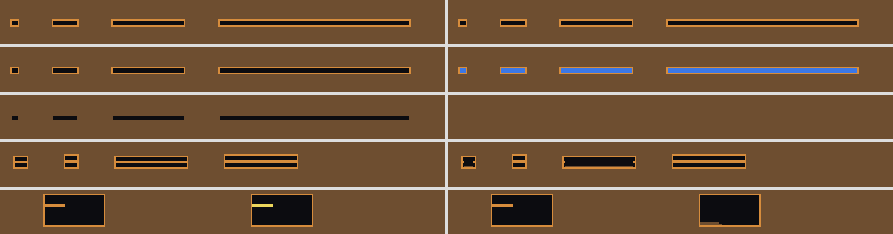
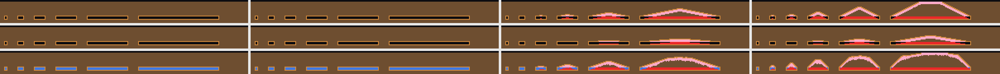

# How real is the ground? Soil physics for the ant and for the plants (2026-10-21)

*Status: research and measurement, then four engine switches, **all off by
default** (§10; the owner asked for them on 2026-10-21 with "switches off by
default"). With every switch unset the engine is unchanged. Four
instruments added (`examples/soil_cases.rs`, `examples/roof_cues.rs`,
`examples/span_readings.rs`, `examples/soil_switches.rs`) and one probe
script (`scripts/roof_probe.py`). Read from `main` at `12be817` and from
PR #747 (`claude/ant-evolution-plant-inspiration-24mykv` at `46ba4b1`) for
soil texture, the floor drain, spells and patchy ground. Requested by the
owner; the brain lane's roof-flag request (2026-10-21 06:00 UTC handoff entry)
is answered in §5.*

**Who should read what.** The ant's roof warning: §0 and §5. Plant soil
signals: §0 and §6. Where the two meet: §7. The engine's soil rules in plain
words, for anyone: §1. What can now be switched on, and what each did when
measured: §10.

## 0. The short version

1. **The ground holds by touch, not by weight.** A worked cell (packed soil)
   stands as long as it touches three of its eight neighbours; a pellet
   (spoil) stands only on something; loose soil falls. Nothing in the soil
   knows how wide a roof is, how much is above it, or how wet it is. So in
   the engine a roof two cells thick stands **at any span**, wet or dry, and
   a roof one cell thick falls **at any span** (§2, picture). Real soil is the
   other way round: span and wetness are what decide a collapse, and
   thickness matters through them.
2. **That is mostly fine for the lab, and it was chosen.** The owner ruled
   that a lab nest should not cave in; a flooded tunnel fills, it does not
   fall. What it costs is that there is no graded middle: a roof is either
   permanent or gone. §5.5 lists the small, legible slumps that would give
   it a middle if the owner wants one.
3. **The ant's roof warning can be a sense instead of a forecast, with no
   loss.** The forecast (`f::ROOF_DROP`) looks only at the 5x5 patch around
   the cut. The same answer comes from a present-tense touch reading: *"a
   grain beside my bite is resting on it (or on air) and has two or fewer
   other grains holding it, or a pellet is sitting on my bite."* On s171's
   own 116,388 Dig options over 48 soil-arena worlds, that one bit agreed with
   the flag on **every** option (8,186 flagged, 0 disagreements). Swapping it
   in should leave s171's scores exactly as they are, which is also the test.
   Without any new sense, the ant's existing 44 features predict the flag
   well but not fully (AUC 0.994, recall 0.89 at precision 0.90): the missing
   cue is the neighbour's hold count.
4. **Plants read soil water as if all soil were loam.** Sand at its own
   field capacity looks two-thirds dry to a root, and clay looks full while
   holding water no plant could pull. Fixing that one function is the
   cheapest change that makes texture matter for niches (§6).
5. **Two things that real soil does to plants are missing outright**: a
   seed buried too deep cannot come up (here any depth germinates, because
   soil does not block light), and dry ground is much harder for a root to
   push through (here hardness never changes with water).
6. **Ants and plants barely touch through the soil.** Spoil and mounds carry
   no extra nutrient (nutrient is kept by position, not in the cell), so the
   best-documented ant-plant link in the literature, the fertile nest mound,
   cannot happen. Tunnels do already carry water down (the wet-roof drip).

## 1. The engine's soil rules, in plain language

Each line says what the rule does and where it lives. "Dead end" means
`Reports/dead-ends.md` holds a tried-and-reverted version.

### 1.1 Kinds of ground

| Ground | What it does | Where |
|---|---|---|
| **Soil** | Loose powder. Falls straight down into any gap and slides off steep slopes. Holds water (0 dry to 1000 saturated). Ants cut it (resistance 0.8, the ant's dig force is 1.0) | `assets/materials/soil.ron` |
| **Packed soil** | What an ant's cut leaves round itself: every neighbour of a cut cell is tamped (`line_burrow`). It does not fall, provided it touches enough ground (below) | `packedsoil.ron`, `creature::pack_neighbours_with` |
| **Spoil** | A pellet an ant put down. Stands only on ground; with nothing under it, it erodes from the bottom up. Kept a pellet by the lining since 2026-09-27 | `spoil.ron`, `update::spoil_footing` |
| **Sand** | Loose, holds **no** water, and **an ant cannot dig it** (resistance 1.4 against dig force 1.0) | `sand.ron` |
| **Gravel, stone** | Not diggable (3.5; solid) | |

### 1.2 What holds ground up

- **The crumb rule.** A worked cell with air directly under it falls when it
  touches fewer than 3 of its 8 neighbours. Animals count as touching
  (`update::worked_cell_gives_way`). This is the whole of roof stability.
- **The footing rule.** A pellet with air, an animal, or anything that is not
  ground under it falls, whatever it touches.
- **Roots.** Soil touching a root (rootwood, grassroot, reedroot) on one of
  its four sides does not fall at all. Binary: one root cell beside it holds
  it completely (`update::root_reinforced`; its comment cites Wu-Waldron and
  names a graded version as an upgrade).
- **No weight, no span, no arching.** Powders are outside `load.rs` and
  `structural.rs`; only stone carries load. Earlier work proposed "dig where
  load is low" from the arching literature (`nest-biology-digging-signals`
  report); there is no load to read.
- **Wet ground does not weaken.** The rule that turned waterlogged lining back
  into loose soil is off by default (`PIXEL_PHYSICS_WET_COLLAPSE`), by the
  owner's ruling that a lab nest must stand (design guide §2b, restated
  2026-09-06). Flooding is the hazard instead. **The comment at
  `src/sim/update.rs:1114-1120` still describes the old behaviour** ("above
  field capacity the wall reverts") and should be corrected by whoever next
  edits that function.
- **Disconnected worked ground** is not checked (`unpack_orphans`, off by
  default for cost: 747-871 ms at 8192x2560).

### 1.3 How hard ground is

A cell is diggable or not: resistance at or below the ant's dig force, a
yes/no (`jaw_can_cut`). The ant's `HARD` feature reads the same constant.
Resistance never changes with water. A root's cost to grow into a cell is the
same constant scaled (`plant::penetration_cost_mult`), times the texture's
factor on PR #747; also without water.

### 1.4 Water in the ground

Soil water is a number in each soil cell: 0 dry, 180 wilting point, 620 field
capacity, 810 waterlogged, 1000 saturated (`material.rs`). **Opposite to
liquids, where 0 means full.**

- **Drainage**: soil above field capacity passes a quarter of its surplus
  down each step (scaled by texture on PR #747).
- **Capillary flow**: water moves from wetter to drier at 6% of the
  difference, stopping when the difference is small: within 380 when the
  wetter cell is above field capacity, within 60 otherwise (dead ends lines
  217-218, 426-427 record why).
- **Sideways levelling of wet ground is off** by default (owner,
  2026-09-11), so rain soaks down in vertical stripes
  (`soil-water-columns-2026-09-11.md`).
- **A wet roof drips** into the tunnel under it; **water runs down beside a
  root or stone** rather than pooling (PR #747).
- **The lab bed drains through its floor** (PR #747, `lab::rain::drain`: the
  bottom row gives up its surplus over field capacity), and **wet and dry
  spells** (20,000 frames misted, 40,000 vented) exist, off in the played box.
- **Damp soil dries** from the surface (`evaporation::schedule_damp_soil`).
- **The coarse moisture field is a different thing** from the soil's own
  water, and it reads bone dry wherever a plant or fuel stands: a 16x16 block
  holding a plant is skipped by sideways diffusion (comment in `field.rs`:
  "96.8% of grass cells reading moisture exactly 0.000"). The brief cites this
  as open bug §Z39; **there is no §Z39 in the register on any branch** (the
  highest is §Z38), so it is unfiled. Decay reads this field
  (`DECAY_MOISTURE_THRESHOLD`), so litter under plants rots as if dry.

### 1.5 Soil texture (PR #747)

Three textures, told apart by the soil's palette colour: loam (field
capacity 620, drainage 1.0, nutrient 0.75, root cost 1.0), rich clay-loam
(740, 0.4, 1.0, 1.3) and sandy (470, 2.5, 0.4, 1.0). The code says the values
are "picked to make each difference legible, not measured". `Ground::Patchy`
lays them out in patches with shallow hollows; it is off in the played lab
pending the owner's call (§8 M1 step E of the plant-community plan).

### 1.6 What a plant reads from the ground

- **Water**: `absorb_water` drinks from the four neighbours of a root cell at
  `plant_available_fraction`, which maps 180..620 to 0..1 **for every
  texture** (`update.rs`, unchanged on PR #747).
- **Germination**: a seed needs to rest on something, light at or above its
  threshold (herb 0.1) and available water at or above its threshold (herb
  0.15) in the cell below.
- **Burial**: any ground over a seed makes it a buried seed
  (`plant::bury_or_unearth`). It still germinates: **powder does not block
  light** (`field::rebuild_blocked` blocks only solids and plants; dead ends
  line 226), so depth costs a seed nothing.
- **Nutrient**: a per-chunk store keyed by **position**, drawn down by roots
  and recovering over time, scaled by texture. Nothing in a cell carries
  nutrient, so moving soil cannot move fertility; litter crediting nutrient is
  a recorded double dead end (a pump).
- **Litter** rots into dry loam-family soil; only roots return to soil since
  PR 716, which fixed the rising ground.

## 2. Pictures: what decides whether a roof stands

*`cargo run --release --example soil_cases -- png=cases.png`. A flat
material map, not the game's render: brown loose soil, orange packed soil,
yellow spoil, blue water, black open. Left frame 0, right frame 1,200. Counts
in `img/soil-physics-2026-10-21/cases.txt`.*

| Row | What was cut | Ground fallen into the hole |
|---|---|---|
| 1. dry bank (water 250) | lined chambers 3 tall, spans 4, 16, 48, 128 | **0** at every span |
| 2. saturated bank (1000) | the same | **0** at every span. The chambers fill with water instead (blue): the wet roof drains into them |
| 3. loose soil, no lining | the same | **all of it** (12/12, 48/48, 144/144, 384/384): the positive control |
| 4. a lined slab between two holes | thickness 1 and 2, at spans 8 and 48 | thickness 1 falls at both spans (2 of 8 and 2 of 48 cells left, the ends); thickness 2 stands at both (16/16, 96/96) |
| 5. a ledge over a pit, 2 thick and 14 long | packed soil, then spoil | packed stands (28/28); spoil erodes away entirely (0/28) |

Row 4 is the engine's whole stability rule in one picture: thickness decides,
span never does. Row 2 is the owner's ruling working as intended: water, not
caving.

## 3. The real thing

**Soil strength at ant scale is mostly water.** Damp sand and soil hold
together by capillary bridges between grains ("apparent cohesion"). It rises
from zero in dry soil to a peak at intermediate wetness and falls again
towards saturation (Lu & Likos 2013; Wang et al. 2021; one silty sand peaked
at about 11% water and was weaker than dry sand above it, Lei 2013).
Ravindran & Gratchev (2022) measured an 89% fall in apparent cohesion from 0%
to 30% water in coarse landslide soils. So **both** a dry and a saturated
tunnel are weak; a damp one is strongest.

**Ants dig where the ground will hold a tunnel.** Fire ants built nests in
every moisture but the driest and the saturated, and their deepest tunnels
came at intermediate moisture, matching the soil's cohesive strength
(Monaenkova et al. 2015). Leaf-cutting ants prefer to dig moister soil, then
less when it gets very wet, and stop digging about 12 mm above standing water
(Pielström & Roces 2014). Tunnel stability in granular media depends on grain
size and water (Espinoza & Santamarina 2010).

**Tunnels stand by arching, and ants exploit it.** Removing grains from a
tunnel face redistributes load into force chains around the opening; ants dig
preferentially where those chains leave grains under little load, which is
also where removal is safe (Buarque de Macedo et al. 2021). **There is no
local rule that predicts stability from the neighbouring grains alone** in a
real granular pile (Pal, Buarque de Macedo & Andrade 2021). Real ants do not
forecast; they dig what comes away easily, line and pack walls, and repair
after a fall.

**Ants build their walls.** Harvester ants use about half of what they
excavate as backfill and lining (Halfen & Hasiotis 2010); soil near Formica
galleries is denser than the soil around it, and nests change the soil's
water properties (Drager, Hirmas & Hasiotis 2016, both papers). Tunnel width
scales with body length, about 1.06 L (Gravish et al. 2013, via
`nest-excavation-mechanics-2026-09-19.md`).

**Ant nests change water entry.** Nest galleries are macropores: ant-affected
soil had lower bulk density, more organic matter and more macropore flow
under simulated rain (Cerdà & Jurgensen 2008); nest effects on infiltration
depend on landscape position (James et al. 2008); burrows carry preferential
flow on the Loess Plateau (*Eur. J. Soil Sci.* 2019, below).

**Plant water depends on texture.** Field capacity and wilting point are
both texture-dependent: sandy sodosols around 20% and 9% water by volume,
clay vertosols around 44% and 29% (Rab et al. 2011). The *available* water,
the gap between them, is what a plant can use, and it does not scale with
the total (Kirkham 2014, ch. 10).

**Roots and dry ground.** Root elongation roughly halves at a penetrometer
resistance of about 0.8-2 MPa and stops near 2-5 MPa; resistance rises
steeply as soil dries, so drought and hardness arrive together (Bengough et
al. 2011; Whalley et al. 2005; Gao et al. 2012). Roots also follow and make
channels: root channels speed a wetting front by 33-113% (Wang et al. 2022).

**Shallow and deep roots partition water.** Walter's two-layer idea: grasses
take topsoil water, woody plants also reach deeper water (Ward, Wiegand &
Getzin 2013). Tracer studies support it in part: in one savanna trees took
59% of tracer at 20 cm, grasses 61% at 5 cm (Kulmatiski et al. 2010); the
global picture is mixed (Kulmatiski & Beard 2022; Holdo 2013). It needs a
deep store that the surface does not drain.

**Burial and emergence.** Emergence falls with depth; most small seeds come
up only from the top 1-2 cm (Viola: over 67% at 0-2 cm, under 15% at 2 cm for
one seed type, Wang et al. 2023; eelgrass: 48-57% from the top 2 cm, 5% from
8 cm, Jørgensen et al. 2019). The depth a seed can emerge from grows with its
reserves, roughly as the cube root of seed mass (Kluyver et al. 2013).

**Where ants and plants meet.** A meta-analysis found ant nests are nutrient
hotspots, driven by refuse; plants grow larger on them, while plant density
and diversity are unchanged (Farji-Brener & Werenkraut 2017). Harvester ant
mounds had more nitrate, ammonium, phosphorus and water than nearby soil
(Wagner 1997; Wagner & Nicklen 2010). Ants shift soil pH towards neutral and
raise N and P around nests (Frouz & Jílková 2008).

## 4. Mechanism by mechanism

| Mechanism | Verdict | What matters at play scale |
|---|---|---|
| Loose soil falls, slides to a slope | Realistic | Reads right |
| Lining makes worked walls stand | Simplified but fair: ants do pack and line | Lets the lab hold a nest, as ruled |
| Roof stability by contact count only | **Wrong in kind**: no span, no load, no moisture | A 128-wide chamber stands forever; a 1-thick slab of any width falls. Invisible in play unless an ant makes a wide room |
| Spoil needs footing | Simplified but fair | Undercut heaps slump, which reads well |
| Wet ground does not weaken | Wrong, chosen | Owner ruling; flooding is the hazard |
| Dig as a hardness threshold, no water term | Simplified, missing the main real lever | Ants cannot prefer damp soil for digging; `WET` is a separate cue with no physical effect on digging |
| Ants cannot dig sand | Wrong for real sand, harmless in the lab (no sand there) | Matters if sand appears in a bed |
| Roots hold soil, binary | Simplified | A single root cell pins a bank |
| Infiltration, drainage, capillary, floor drain | Simplified but fair | Columns from the sideways switch are visible only in the overlay |
| Wet roof drips into tunnels | Realistic | The one ant-to-water link that exists |
| Texture (PR #747) | Fair in direction, sizes chosen to be legible | Correct order: sand drains and dries first |
| Plant available water ignores texture | **Wrong** | Sand plants drought early, clay plants never feel drought |
| Burial without depth limit | **Wrong** | A seed under a spoil heap comes up anyway |
| Root cost ignores dryness | Wrong, missing | Dry clay is as easy as wet clay |
| Nutrient by position, not in the cell | Simplified, blocks the mound link | Spoil cannot fertilise |
| Decay reads the coarse field under plants | Wrong (the unfiled §Z39 effect) | Litter under a plant rots as if dry |

## 5. The ant: a roof warning from touch

### 5.1 What the forecast actually reads

`creature::cut_drops_roof` builds the world one cut ahead (the cell gone, its
neighbours lined) and asks whether any neighbour now fails the crumb or
footing rule when it did not before. Every cell it reads is within two of the
cut. So the information is local; the objection is that it is computed by
simulating the cut, which no ant does.

The present-tense reading with the same reach is:

> **HANGING** (on a Dig option): some grain touching the target rests on the
> target or on open air, and is held by two or fewer other grains; or a
> pellet rests on the target.

Every term is something a body pressed against the face can feel now: a grain
sitting on what it is biting, open space under a grain beside it, how little
else that grain is wedged against. Nothing is built ahead. It is the
grain-scale version of what Buarque de Macedo et al. (2021) describe ants
using, how firmly material around the face is held, and it stops short of
what Pal et al. (2021) say cannot exist, a stability prediction: it says
which grain is barely held, not what will happen.

### 5.2 Measurement: does it match, and do the existing features already carry it?

Method: the teacher session's probe (`probe.py` on `ccr-439ee31b-pn36yq`),
reimplemented for this label in `scripts/roof_probe.py`: a linear model and a
16-unit hidden layer (the brain's scorer size), scored on held-out **worlds**
(4 folds by world). Data: s171's hold-best genome in the brain lane's own
soil arena (`challenges::Soil`, step 4, 8-row shaft, foot pay, 1,200 J,
12,000 frames), 24 sealed and 24 hold-out layouts, every Dig option the ant
was offered every 5 frames, with all 45 features as its brain saw them
(`examples/roof_cues.rs`, `genome=` mode). The flag fired on 7.0% of 116,388
options (8,186). Controls: a label that is a pure function of the inputs
(`lined`) reads AUC 1.000; the flag shuffled between worlds reads 0.502-0.511.
Full output: `img/soil-physics-2026-10-21/roof_probe_s171.txt`.

| Inputs | AUC | Recall | Precision |
|---|---|---|---|
| The touch features the brief names (DROP_BELOW, HEADROOM, ROOFED, CUT, LINED, HARD, WET, kinds, STAND/FALL/CLIMB, UP, DEPTH), 16 units | 0.983 | 0.72 | 0.93 |
| Every option feature except the flag (44), linear | 0.965 | 0.70 | 0.76 |
| Every option feature except the flag (44), 16 units | 0.994 | 0.89 | 0.90 |
| The 44 plus the weakest neighbour's hold count | 1.000 | 0.97-0.98 | 0.96-0.99 |
| **HANGING, one bit** | **1.000** | **1.00** | **1.00** |

Row by row, HANGING and the flag agreed on all 116,388 options: both 8,186,
flag only 0, cue only 0.

Against what the engine then does (the cell cut in a copy of the world,
stepped 3 frames, beside an uncut twin; 11,671 options): the flag catches 99%
of real drops at 69% precision. Its false alarms are grains an animal's body
is holding up, which the engine counts as support for as long as the body
stays and the flag (rightly) does not; in the colony mode of `roof_cues`,
where many ants crowd the face, that is visibly most of them.

### 5.3 Recommendation

1. **Replace `f::ROOF_DROP` with HANGING in the same slot.** On these 48 worlds
   it is the same bit, so s171 with HANGING should reproduce the intact run
   exactly (9.79 / 10.90 full loads, 0.12 / 0.04 falls a world). That
   identical run is the positive control for the swap, and it means the swap
   costs no retraining. The brain's hand-seeded link (+40 at `mind.rs:809`)
   carries over unchanged.
2. **Name it as a sense, not a forecast**, in `options.rs` and
   `how-the-ant-works.md`: "a grain beside the bite is barely held".
3. **If the owner prefers no new bit**, the ant's existing features carry most
   of it (AUC 0.994), so a retrained brain could learn it, but the probe says
   about one flagged cut in ten would be missed at that precision. The cost of
   having no warning is about 1.5 full loads and 1.5 falls a world (brain lane
   handoff, 2026-10-21 06:00), so that tenth is not free. A graded version
   (the weakest neighbour's hold count, 0-8) is the middle path and scores
   AUC 0.992 alone.
4. **Not measured here**: the cost of computing HANGING against the forecast
   (it reads at most the 8 neighbours' rings, no world copy, so it should be
   no dearer), and whether a brain trained from scratch with it behaves the
   same. Both belong to the brain lane.

### 5.4 Other touch cues that would make the ant more real

Ranked by how much they would change behaviour on screen, cheapest first:

1. **Wet changes hardness.** Make the effective resistance of soil depend on
   its water, softest and best-holding at intermediate wetness, so `HARD`
   varies with `WET` the way real cohesion does (§3). Ants would then prefer
   damp ground for the reason real ones do. Cheap: one function of `aux` in
   `penetration_resistance` reads; needs the dig threshold to stay reachable
   at the extremes.
2. **A pellet overhead.** Spoil above the target is the only ground that
   erodes on its own; a cue for "pellet in the ceiling" would let an ant avoid
   tunnelling under its own dump. Local, one cell.
3. **Width of the opening overhead.** Count open cells along the roof row
   either side of the target. Real ants keep tunnels near one body length
   wide (Gravish et al. 2013); this would only matter if roofs ever get a
   span limit (§5.5).
4. **Not recommended**: CO2 as a depth cue (`nest-biology-digging-signals`
   found gravity, not CO2, is the depth cue); any reading of a load field,
   since powders have none.

### 5.5 What should make a tunnel collapse (owner's call)

The ruling stands: a lab nest must be diggable and must not cave in. If the
owner wants a middle between "permanent" and "gone", these are the realistic,
local options, each small and legible, none on by default:

| Change | Real basis | On screen | Cost |
|---|---|---|---|
| Spans beyond a generous limit (real chambers span many body lengths; tighter when dry or soaked) shed a few roof grains from the middle | Arching weakens with span | Very wide rooms get a sag and a scatter on the floor, not a cave-in | One row scan per worked cell with air beneath |
| Saturated walls shed a grain now and then, dry ones crumble at the rim | Cohesion falls at both ends of wetness | Flooded tunnels silt up slowly | A moisture term in the crumb rule |
| Graded root hold (more roots, firmer bank) | Root reinforcement grows with root density | Banks with sparse roots slump at the edge | Count of root neighbours instead of any |

Each would need the HANGING cue (§5.3) to include its new failure, which is
local in every case.

### 5.6 The third dimension: is a wide void a room or a tunnel?

*Raised by the owner on reading §5.5, 2026-10-21; the choice is pending.
Both readings are now drawn side by side (§10.1) and the glass-farm rule is
a switch.*

The screen is one vertical plane. A roof's real span is the shorter of its two
horizontal sizes, and one of them is off screen, so a void 128 cells wide could
be a great room or a body-wide tunnel running across the view. The physics
that is realistic depends on which the world is taken to be:

- **Deep slice of a 3D world.** A wide void is most likely a body-wide tunnel
  seen side-on, so its true span is about one body whatever its width on
  screen. The engine's width-blind rule is then defensible, and only the
  wetness effects of §5.5 are worth adding. This is how the repo already
  reads trees: a branch one cell wide is not a shelf spanning the whole wood
  (`wiki/liquids-and-gases.md`).
- **Glass ant farm (thin slab).** The world is a slab a body or two deep
  between panes. Width on screen *is* the span, and a span limit is the
  realistic rule. The lab is a sealed box, and thin glass formicaria are a
  standard real setup, so this reading is literally true there; the outdoor
  and held worlds read better as a slice.

Two facts keep either reading from over-promising. The real span limit is
generous: chambers span many body lengths in damp soil, so a limit caps very
wide rooms and does not force narrow tunnels. And body-wide tunnels come
mostly from the ant, not the soil: narrow tunnels let ants brace with legs and
antennae and arrest falls while climbing: fire ants dig tunnels 1.06 body lengths
across, and below 1.31 body lengths every induced fall was arrested (Gravish et
al. 2013). In this
engine, then, narrow tunnels would come from fall risk on the climb, not from
roof collapse.

## 6. The plants: what the ground should tell a root and a seed

### 6.1 Signals a root or a seed should read locally

| Signal | Real basis | Exists now |
|---|---|---|
| Water a plant can pull, relative to **this soil's** wilting point and field capacity | Rab et al. 2011; Kirkham 2014 | `water_status` and `plant_available_fraction`, texture-blind |
| How hard the next cell is, **rising as it dries** | Bengough et al. 2011 | `penetration_cost_mult`, constant per material and texture |
| Nutrient where the root is | Farji-Brener & Werenkraut 2017 | `nutrient_status`, kept by position per chunk |
| How deep a seed is under ground | Kluyver et al. 2013 | `overburden_depth` exists as a diagnostic only |
| Waterlogging (no air at the root) | | the waterlogged constant (810) exists; no plant reads it |

### 6.2 Which soil differences make niches, ranked by cost and effect

| Rank | Change | Cost | On screen |
|---|---|---|---|
| 1 | **Texture-aware available water**: map each texture's own wilting point and field capacity to 0..1 | One function, plus re-deriving the germination and drought constants calibrated against the loam scale | Sandy patches carry drought-tolerant plants, clay carries the thirsty ones; makes patchy ground (PR #747) do what its wiki text promises |
| 2 | **Emergence depth**: a buried seed germinates only within a depth set by its reserve (cube root of seed mass) | Moderate: `overburden_depth` already counts it; needs a species field | Seeds under spoil heaps and litter stay down; burial becomes graded |
| 3 | **Dry ground is harder for roots** | One term in `penetration_cost_mult` | Deep roots grow in wet spells; drought stops them |
| 4 | **A deep store the surface does not drain** (the two-layer niche) | Moderate: drying profile and drain depth | Shallow grass and deep shrubs stop meeting the same water; plan step 2 measured roots at 0.52 against 0.80 while the top band barely dries |
| 5 | **Nutrient in the cell**, so spoil and middens can carry it | Large: nutrient moves from a position buffer to the cell, and the pump dead end must be designed around | Nest mounds green up |
| 6 | Graded root reinforcement | Small | Little in the lab |

## 7. Where ants and plants meet

- **Spoil buries seedlings.** It already does (`bury_or_unearth`), but without
  an emergence limit (§6.2 rank 2) burial costs nothing, so the most visible
  ant effect on plants is missing.
- **Mounds are fertile in reality, not here.** Needs nutrient in the cell
  (§6.2 rank 5).
- **Tunnels carry water down.** The wet-roof drip already does this.
- **Roots hold tunnels.** Roots pin soil completely; a root beside a gallery
  makes the wall unbreakable. Graded hold would make it a firmer wall rather
  than a permanent one.
- **Moisture is shared.** A cohesion that depends on water (§5.4, 1) and a
  texture-aware plant water (§6.2, 1) read the same `aux`, so one wet spell
  would change both where ants dig and which plants grow.

## 8. Records and traps found on the way

- **§Z39 is not filed.** The fact behind it (the moisture field reads 0 where
  a plant stands) is in a `field.rs` comment; decay and anything else reading
  that field are affected. Worth filing.
- **Stale comment**: `src/sim/update.rs:1114-1120` describes wet reversion as
  live; it is off by default.
- **`plant_available_fraction` is texture-blind on PR #747.** The patchy-ground
  measurements there (moisture spread 0.09-0.12) are of soil water, not of what
  plants can use; sand's figure overstates its drought and clay's understates
  it.

## 9. Instruments

- `examples/soil_cases.rs`: the five-row picture in §2, with a census per hole
  and per built structure; loose soil is its positive control.
- `examples/roof_cues.rs`: two modes. Default: a shipped-ant colony on a soil
  bank, every cuttable face cut in a copy and compared with an uncut twin,
  touch cues scored against what fell. `genome=<file> csv=<file>`: the soil
  arena with a trained genome, every Dig option written with its 45 features,
  the engine's verdict and the touch cues.
- `scripts/roof_probe.py`: the probe in §5.2, with its positive and negative
  controls. About 9 minutes on 116k rows.
- `examples/span_readings.rs`: §10.1's pictures. One span rule under the
  readings of §5.6, on lined test chambers and on real nests (s171's, a
  shipped colony's, the lab box's), at three wetnesses, with fallen ground
  painted and counted.
- `examples/soil_switches.rs`: §10.3's census. The lab box run through the
  lab's own tick, with plants, root cells, germinations, buried seeds by
  depth, and the moisture of the ground at the root front; an A/B is two
  runs, one with a switch set.

## 10. The switches (built 2026-10-21, all off by default)

The owner asked, overnight, for some of the suggestions to be built behind
switches that are off by default, to see how the soil could be improved.
Four are built. Each is one environment variable, read once per process; with
it unset the code path is the shipped one, so every number elsewhere in the
repo still holds.

| Switch | What it does | Default | Measured |
|---|---|---|---|
| `PIXEL_PHYSICS_ROOF_SPAN` (`on` = 12, or a number) | A worked roof over an opening wider than the ground can span sags from the middle, as a dome that stops on its own. The span peaks in damp ground and shrinks when dry or soaked | off | §10.1 |
| `PIXEL_PHYSICS_ROOF_SENSE=touch` | The ant's roof warning comes from what it can feel now, not from a forecast | `forecast` | §10.2: identical on s171 |
| `PIXEL_PHYSICS_DRY_ROOT_COST` (`on` = 2, or a multiplier) | A root pays more to grow into dry ground: up to 2x at the wilting point, nothing extra at field capacity | off | §10.3 |
| `PIXEL_PHYSICS_EMERGENCE_DEPTH` (`on` = 6, or a depth in cells) | A seed buried deeper than its reserve allows stays dormant until the cover is dug or washed off it | off | §10.3 |

**Frame cost.** Off, each is one cached flag read on a path that is already
per-event (a roof cell's crumb check, a Dig option, a root step, a waiting
seed). On, paired 20,000-frame lab runs with the span rule took 20.2, 18.3 and
19.7 s against 19.3, 19.8 and 19.2 s off; the plant switches' 60,000-frame
runs took 103/95/83 s (dry roots) and 112/102/62 s (emergence) against
108/97/61 s off. All within run-to-run noise; none is a measured harm.

### 10.1 The span limit (`PIXEL_PHYSICS_ROOF_SPAN`)

`update::over_span`: a worked roof cell with open space under it fails when
it is more than `half_span x cohesion(moisture)` cells from the nearer wall
of the opening beneath it. The cohesion curve's **shape** is sourced
(capillary cohesion peaks in damp ground and falls when dry or soaked; Lu &
Likos 2013, Monaenkova et al. 2015): 0.35 dry, 1.0 from 450 to 700, 0.25
soaked. Its **size** is chosen: a damp half-span of 12 cells, so a damp roof
holds 24 cells (twelve body lengths) and a dry one about 8.

**Re-lining is what makes it a sag and not a cave-in.** A failed lining
cell turns back into loose soil, and without more the loose bank above it
then pours through the gap as a chimney. So each failure packs the three
cells over it, the way the ant's cut lines what it exposes: the new lining
is one row higher and, because the failed row narrowed the opening under
it, slightly shorter, so the sag stops on its own as a dome.

*Lined chambers 2 to 96 cells wide. Rows: dry, damp, soaked. Columns: today
(no span rule), deep slice (span is at most a body width into the screen, so
nothing sags), glass farm (span is the width on screen), farm at half the
span. Red is ground that arrived, pink is where it left.*

| Chambers, cells that fell | today | slice | farm | farm/2 |
|---|---|---|---|---|
| dry | 0 | 0 | 332 | 446 |
| damp | 0 | 0 | 168 | 300 |
| soaked | 0 | 0 | 405 | 526 |

The engine's own run with `PIXEL_PHYSICS_ROOF_SPAN=12` matched the harness's
farm column at 332 / 168 / 406 cells against 332 / 168 / 407, so the
switch is the rule pictured. **Real nests barely notice it.** At the farm
reading, damp ground fails nothing in s171's nests, the colony banks or the
lab box; dry or soaked ground sheds a handful of cells; at half the span,
up to 10. Today's ants dig narrow, so this rule caps very wide rooms and
leaves the nest as it is. Per-scene counts: `img/soil-physics-2026-10-21/span/span.txt`,
with the sheets beside it.

**Under the deep-slice reading this switch should stay off**: the slice's
column is identical to today's on every scene. It is the glass-farm rule.

### 10.2 The touch roof sense (`PIXEL_PHYSICS_ROOF_SENSE=touch`)

`creature::options::hanging` replaces `cut_drops_roof` as the source of
`f::ROOF_DROP` when the switch reads `touch`. It is §5.3's bit: a powder grain
touching the bite rests on the bite or on open space and has two or fewer
other holds, or a pellet rests on the bite. Every cell it reads is within two
of the bite and read as it is now.

**s171 plays exactly the same game with it.** `roof_cues genome=<s171>`
under the forecast and under `touch` wrote byte-identical CSVs (116,388 Dig
options, 8,186 flagged, md5 `3876df91...`), and those CSVs carry the brain's
whole feature vector at every decision, so the trajectories, and hence the
scores, are the same (`img/soil-physics-2026-10-21/roof_sense.txt`). An
unknown value for the switch panics on the first Dig option, which is the
check that the run read it.

The guard, `the_touch_roof_sense_matches_the_forecast_at_a_founding_cut`,
holds the two equal on every cuttable cell around the soil arena's founding
cut with pellets on the surface, and was watched red with the hold count at
one and at four (it stayed green at three, where no grain in that scene sits)
and with the footing term removed.

**Where the two part.** The forecast also sees a sag that `ROOF_SPAN` would
cause; the touch bit does not, because how wide the opening under a grain is
is not something a body at the face feels. With both switches on, the ant
gets no warning of a span sag. That is the realistic outcome under §5.6's
farm reading (a real ant has no such warning either), and the reason the
swap is the brain lane's to make, not this report's.

### 10.3 Dry roots and buried seeds

**Dry ground is harder ground** (`plant::dry_root_cost`). The root's bill
for a cell, `penetration_cost_mult`, is multiplied by `1 + (k - 1) x (1 -
available)`, where `available` is `plant_available_fraction`, the same
quantity the root drinks: `k` at or below the wilting point, 1.0 from field
capacity up. Shape from Bengough et al. 2011 (penetration resistance rises
steeply as soil dries); `k = 2` is the gentle end of a several-fold real rise.

**A seed buried too deep stays down** (`plant::emergence_depth`). A buried
seed under more than `depth x cbrt(endowment / 0.2)` cells of cover does not
germinate; it waits on its half-life, and comes up if the cover goes. The
cube root is Kluyver et al. 2013; 0.2 is the middle of the shipped seed costs,
so grass (0.12) comes up through 5 cells and a tree (0.3) through 6 at
`on`'s depth of 6.

Both have unit tests on their curves (`dry_ground_costs_a_root_more...`,
`a_seed_comes_up_through_cover...`). In the lab box they change little,
for reasons the census shows:

| Lab box, 60,000 frames, seeds 1/2/3 | plants | root cells | germinations |
|---|---|---|---|
| Light rain, all off | 572 / 715 / 533 | 2990 / 3226 / 2568 | 293 / 381 / 345 |
| Light rain, dry roots on | 560 / 625 / 492 | 3128 / 3157 / 2916 | 333 / 349 / 453 |
| Light rain, emergence on | 559 / 724 / 500 | 3358 / 3026 / 2242 | 275 / 431 / 330 |
| Mister off, all off | 748 / 643 / 492 | 3805 / 3265 / 2759 | 194 / 177 / 145 |
| Mister off, dry roots on | 628 / 724 / 548 | 2724 / 3654 / 2340 | 151 / 246 / 224 |

- **Dry roots: the root front is mostly wet.** Under light rain the mean
  bill `on` would charge over every soil cell touching a root is 1.07-1.16x;
  with the mister off it climbs to 1.29-1.30x by 60,000 frames as the ground
  dries. The arms differ by less than seeds differ from each other, in both
  directions. The term is wired and bills what it should; at this box's
  wetness and run length it does not yet decide anything. The test of it is
  a long drought, where it should show as roots that stop deepening.
- **Emergence: few seeds are ever buried deep.** At 60,000 frames 1 to 14
  seeds per box stand under 7 or more cells of cover; the limit holds those
  and nothing else, so the stand does not move. It would matter where seeds
  are buried in numbers: under spoil heaps, slumps, or a span sag.

Neither is ready to default on: both multiply into economies calibrated
without them, and neither has yet been seen to change what is on screen.
Full lines per stop: `img/soil-physics-2026-10-21/switches.txt`.

## 11. Sources

Ant digging and tunnels
- Espinoza, D.N. & Santamarina, J.C. (2010). Ant tunneling: a granular media perspective. *Granular Matter* 12. doi:10.1007/s10035-010-0202-y
- Monaenkova, D. et al. (2015). Behavioral and mechanical determinants of collective subsurface nest excavation. *J. Exp. Biol.* 218:1295. doi:10.1242/jeb.113795
- Pielström, S. & Roces, F. (2014). Soil moisture and excavation behaviour in the Chaco leaf-cutting ant. *PLOS ONE*. doi:10.1371/journal.pone.0095658
- Buarque de Macedo, R. et al. (2021). Unearthing real-time 3D ant tunneling mechanics. *PNAS*. doi:10.1073/pnas.2102267118
- Pal, A., Buarque de Macedo, R. & Andrade, J.E. (2021). Granular Matter. doi:10.1007/s10035-021-01141-2
- Halfen, A.F. & Hasiotis, S.T. (2010). *PALAIOS*. doi:10.2110/palo.2010.p10-005r
- Gravish, N., Monaenkova, D., Goodisman, M.A.D. & Goldman, D.I. (2013). Climbing, falling, and jamming during ant locomotion in confined environments. *PNAS* 110:9746. doi:10.1073/pnas.1302428110

Ants and soil water
- Drager, K.I., Hirmas, D.R. & Hasiotis, S.T. (2016). *SSSAJ*. doi:10.2136/sssaj2015.08.0300; and *Soil Science*. doi:10.1097/SS.0000000000000145
- Cerdà, A. & Jurgensen, M.F. (2008). *J. Appl. Entomol.* doi:10.1111/j.1439-0418.2008.01267.x
- James, A.I. et al. (2008). Landscape position moderates how ant nests affect hydrology and soil chemistry. *Landscape Ecology*. doi:10.1007/s10980-008-9251-6
- Small-scale observation on the effects of burrowing activities of ants on soil hydraulic processes (2019). *Eur. J. Soil Sci.* doi:10.1111/ejss.12748
- Frouz, J. & Jílková, V. (2008). The effect of ants on soil properties and processes. *Myrmecol. News* 11:191

Soil strength and water
- Lu, N. & Likos, W.J. (2013). Origin of cohesion and its dependence on saturation. doi:10.1061/9780784412992.197
- Wang, Q. et al. (2021). *Acta Geotechnica*. doi:10.1007/s11440-021-01375-7
- Ravindran, S. & Gratchev, I. (2022). *Geotechnics* 2:17. doi:10.3390/geotechnics2020017
- Lei, S. (2013). doi:10.3969/j.issn.1671-8879.2013.05.001
- Rab, M.A. et al. (2011). *Soil Research*. doi:10.1071/SR10160
- Kirkham, M.B. (2014). *Principles of Soil and Plant Water Relations*, ch. 10. doi:10.1016/B978-0-12-420022-7.00010-0

Roots
- Bengough, A.G. et al. (2011). *J. Exp. Bot.* doi:10.1093/jxb/erq350
- Whalley, W.R. et al. (2005). *Soil & Tillage Res.* doi:10.1016/j.still.2004.08.003
- Gao, W. et al. (2012). *Soil & Tillage Res.* doi:10.1016/j.still.2012.07.006
- Wang et al. (2022). *Forests* 13:1095. doi:10.3390/f13071095

Two-layer hypothesis
- Ward, D., Wiegand, K. & Getzin, S. (2013). *Oecologia*. doi:10.1007/s00442-012-2538-y
- Kulmatiski, A. et al. (2010). *New Phytologist*. doi:10.1111/j.1469-8137.2010.03338.x
- Kulmatiski, A. & Beard, K.H. (2022). *Ecology Letters*. doi:10.1111/ele.14067
- Holdo, R.M. (2013). *PLOS ONE*. doi:10.1371/journal.pone.0069625

Seeds and burial (PubMed)
- Kluyver, T.A. et al. (2013). *J. Exp. Bot.* 64:4101. doi:10.1093/jxb/ert304
- Jørgensen, M.S. et al. (2019). *PLOS ONE* 14:e0215157. doi:10.1371/journal.pone.0215157
- Wang, H. et al. (2023). *J. Plant Res.* 136:631. doi:10.1007/s10265-023-01461-9

Ants and plants
- Farji-Brener, A.G. & Werenkraut, V. (2017). *J. Anim. Ecol.* doi:10.1111/1365-2656.12672
- Wagner, D. (1997). *J. Ecol.* doi:10.2307/2960629
- Wagner, D. & Nicklen, E.F. (2010). *J. Ecol.* doi:10.1111/j.1365-2745.2010.01640.x
